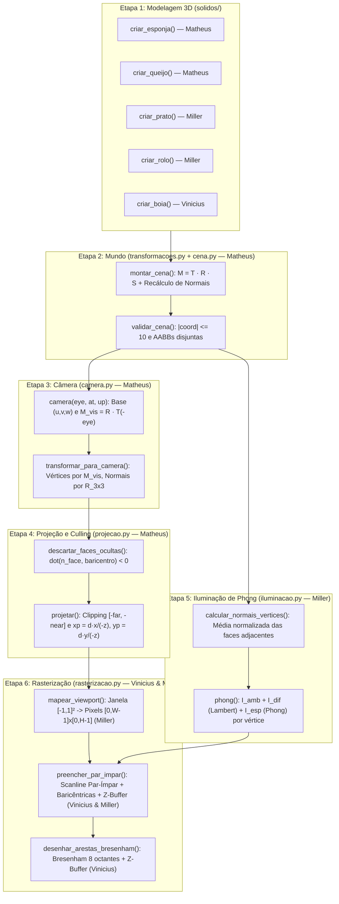

# Plano de Estudo Detalhado — Visão Geral da Equipe (Matheus, Miller e Vinicius)

**Instituição:** Instituto Federal de Educação, Ciência e Tecnologia do Ceará (IFCE) – Campus Fortaleza  
**Curso:** Engenharia da Computação | **Disciplina:** Computação Gráfica (2026.2)  
**Professor:** Prof. Dr. Ajalmar Rocha Neto  
**Equipe:** Matheus, Miller e Vinicius  

---

## 1. Visão Geral: Mapa Completo do Trabalho (Edital $\times$ Equipe $\times$ Código $\times$ Relatório)

Como destaca a **Obs4** da especificação (<code style="color: #ef4444; font-weight: bold;">docs/Trabalho CG 2026_2.docx-2.pdf</code>) e a **Seção 4.6** do plano de ação (<code style="color: #ef4444; font-weight: bold;">docs/plano_de_acao_trabalho_CG.md</code>), **a nota do trabalho é referente à apresentação, na qual qualquer integrante pode ser questionado sobre qualquer etapa do pipeline**.

Este documento apresenta o plano de estudo completo cobrindo o trabalho dos **3 integrantes**, intercalando a fundamentação teórica com a análise prática de **como cada requisito foi implementado no código-fonte** e documentado no relatório técnico final (<code style="color: #ef4444; font-weight: bold;">docs/relatorio_trabalho_cg.pdf</code>).

| Item da Especificação (<code style="color: #ef4444; font-weight: bold;">docs/Trabalho CG 2026_2.docx-2.pdf</code>) | Responsável Principal (<code style="color: #ef4444; font-weight: bold;">docs/plano_de_acao_trabalho_CG.md</code>) | Módulo e Funções no Código | Seção, Tabelas e Figuras no Relatório (<code style="color: #ef4444; font-weight: bold;">docs/relatorio_trabalho_cg.pdf</code>) |
| :--- | :--- | :--- | :--- |
| **1) Modelar 5 objetos do cotidiano** em malha de triângulos com normais externas unitárias e mostrar no sistema do objeto | **Matheus:** Esponja e Queijo<br>**Miller:** Prato e Rolo<br>**Vinicius:** Boia de piscina | <code style="color: #ef4444; font-weight: bold;">solidos/esponja.py</code>, <code style="color: #ef4444; font-weight: bold;">solidos/queijo.py</code>, <code style="color: #ef4444; font-weight: bold;">solidos/prato.py</code>, <code style="color: #ef4444; font-weight: bold;">solidos/rolo.py</code>, <code style="color: #ef4444; font-weight: bold;">solidos/boia.py</code><br><code style="color: #ef4444; font-weight: bold;">visualizacao_3d.py</code> (`plotar_solidos_isolados`) | **Seção 3.1**, **Tabela 1** e **Figura 1 (Item 1e)** |
| **2) Compor cena no mundo** sem sobreposição/interseção usando escala, rotação e translação com $\|x\|, \|y\|, \|z\| \le 10$ | **Matheus** | <code style="color: #ef4444; font-weight: bold;">transformacoes.py</code> (`escala`, `rotacao_x/y/z`, `translacao`, `transformar_solido`)<br><code style="color: #ef4444; font-weight: bold;">cena.py</code> (`montar_cena`, `verificar_intersecao_aabb`, `validar_cena`) | **Seção 3.2**, **Tabela 2** e **Figura 2 (Item 2b)** |
| **3) Sistema da câmera (VRC):** escolher `eye`, base $(u,v,w)$, transformar objetos, marcar origem do mundo e variar `eye` | **Matheus** | <code style="color: #ef4444; font-weight: bold;">camera.py</code> (`camera`, `transformar_para_camera`, `obter_origem_mundo_na_camera`)<br><code style="color: #ef4444; font-weight: bold;">visualizacao_3d.py</code> (`plotar_cena_camera`, `plotar_variacao_eye`) | **Seção 3.3**, **Tabela 3**, **Figura 3 (Itens 3c–3d)** e **Figura 4 (Item 3e)** |
| **4) Projeção em perspectiva** polígono a polígono na janela 2D, descartando não visíveis, exibindo em 3D + janela 2D | **Matheus** | <code style="color: #ef4444; font-weight: bold;">projecao.py</code> (`descartar_faces_ocultas`, `projetar`)<br><code style="color: #ef4444; font-weight: bold;">visualizacao_pipeline.py</code> (`plotar_projecao_3d_2d`) | **Seção 3.4**, **Tabela 4** e **Figura 5 (Itens 4 e 4a)** |
| **5) Iluminação nos vértices** dos polígonos visíveis (componentes ambiente, difusa e especular) | **Miller** | <code style="color: #ef4444; font-weight: bold;">iluminacao.py</code> (`calcular_normais_vertices`, `phong`)<br><code style="color: #ef4444; font-weight: bold;">visualizacao_pipeline.py</code> (`plotar_iluminacao_phong`) | **Seção 3.5** e **Figura 6 (Item 5)** |
| **6) Rasterização em $\ge 3$ resoluções:** culling por normal, retas por Bresenham (5.2.1), polígonos por par-ímpar com scanline e interpolação baricêntrica | **Vinicius:** Bresenham e Par-Ímpar com Scanline<br>**Miller:** Baricêntricas, Viewport e 3 Resoluções | <code style="color: #ef4444; font-weight: bold;">rasterizacao.py</code> (`bresenham`, `desenhar_arestas_bresenham`, `preencher_par_impar`, `baricentricas`, `mapear_viewport`)<br><code style="color: #ef4444; font-weight: bold;">main.py</code> (`render`) | **Seção 3.6**, **Tabela 5**, **Figura 7 (Item 6)** e **Figura 8 (Itens 3e e 6)** |
| **Obs1 e Obs2:** Relatório completo em PDF e entrega limpa em `.zip` | **Vinicius** (consolidação do relatório) + **Matheus** (<code style="color: #ef4444; font-weight: bold;">main.py</code>, <code style="color: #ef4444; font-weight: bold;">README.md</code>) + **Miller** | <code style="color: #ef4444; font-weight: bold;">gerar_relatorio.py</code>, <code style="color: #ef4444; font-weight: bold;">empacotar_entrega.py</code>, <code style="color: #ef4444; font-weight: bold;">tests/</code> | <code style="color: #ef4444; font-weight: bold;">docs/relatorio_trabalho_cg.pdf</code> e <code style="color: #ef4444; font-weight: bold;">entrega_projeto_cg.zip</code> |

### Arquitetura Completa do Pipeline Gráfico em Software



---

## 2. Etapa 1 — Modelagem Geométrica dos 5 Sólidos e Normais CCW (Item 1)

### 2.1 Teoria Fundamental (Comum aos 3 Integrantes)
- **Contrato de Dados (<code style="color: #ef4444; font-weight: bold;">solidos/__init__.py#L1-L27</code>):** Todo sólido é um `dict` contendo `vertices` $(N,3)$, `faces` $(M,3)$, `arestas` $(K,2)$, `normais_faces` $(M,3)$, `cor` $(r,g,b)$ e `nome`.
- **Orientação Anti-Horária (CCW) e Produto Vetorial:**
  Para qualquer face triangular com índices $[i_0, i_1, i_2]$ e vértices $v_0, v_1, v_2$, a normal é calculada pela regra da mão direita:
  $$\vec{N} = (v_1 - v_0) \times (v_2 - v_0), \qquad \hat{n} = \frac{\vec{N}}{\|\vec{N}\|}$$
  Em todos os 5 arquivos de <code style="color: #ef4444; font-weight: bold;">solidos/</code>, esse cálculo é feito de forma idêntica e 100% vetorizada em NumPy:
  ```python
  v0 = vertices[faces[:, 0]]
  v1 = vertices[faces[:, 1]]
  v2 = vertices[faces[:, 2]]
  normais = np.cross(v1 - v0, v2 - v0)
  normas = np.linalg.norm(normais, axis=1, keepdims=True)
  normais_unitarias = normais / np.where(normas == 0, 1.0, normas)
  ```
- **Fechamento Topológico (*2-Manifold Watertight*):** Toda meia-aresta orientada $(u, v)$ de um triângulo deve aparecer exatamente uma vez na direção oposta $(v, u)$ no triângulo vizinho, garantindo ausência de buracos ou bordas abertas e volume assinado positivo ($V = \frac{1}{6}\sum v_0 \cdot (v_1 \times v_2) > 0$).

---

### 2.2 Prática no Código: Como Cada um dos 5 Sólidos Foi Construído

#### 1. Esponja de Lavar Louça — *Matheus* (<code style="color: #ef4444; font-weight: bold;">solidos/esponja.py#L9-L80</code>)
- **Geometria:** Paralelepípedo centrado na origem com meias-dimensões $(h_x, h_y, h_z) = (\text{largura}/2, \text{altura}/2, \text{profundidade}/2)$.
- **Métricas da Malha:** **8 vértices**, **12 faces triangulares** (2 por face retangular da caixa) e **18 arestas**.
- **Detalhe de Código:** Os vértices `0..3` formam a face traseira ($z = -h_z$) e `4..7` a face frontal ($z = +h_z$). As faces opostas invertem a ordem de indexação (ex.: frontal `[4, 5, 6]`, `[4, 6, 7]` vs. traseira `[0, 2, 1]`, `[0, 3, 2]`) para que ambas as normais apontem para o exterior ($(0,0,+1)$ e $(0,0,-1)$).

#### 2. Fatia de Queijo — *Matheus* (<code style="color: #ef4444; font-weight: bold;">solidos/queijo.py#L9-L81</code>)
- **Geometria:** Prisma triangular em cunha com altura $h$ ($y \in [-h/2, +h/2]$), raio $r$ e ângulo de abertura $\theta$.
- **Métricas da Malha:** **6 vértices**, **8 faces triangulares** (1 na base inferior, 1 na base superior e 2 para cada uma das 3 faces laterais) e **12 arestas**.
- **Detalhe de Código:** No plano $XZ$, os 3 vértices de cada base são o centro $(0,0)$, o ponto $(r, 0)$ em $0^\circ$ e o ponto $(r\cos\theta, r\sin\theta)$. A base inferior usa `[0, 1, 2]` (normal $(0,-1,0)$) e a superior usa `[3, 5, 4]` (normal $(0,+1,0)$).

#### 3. Prato (Sólido de Revolução Fechado com Espessura) — *Miller* (<code style="color: #ef4444; font-weight: bold;">solidos/prato.py#L9-L139</code>)
- **Desafio Técnico Superado (citado na Conclusão do Relatório):** Uma superfície aberta de revolução teria bordas livres e deixaria o fundo invisível quando olhado por cima ou por baixo devido ao *backface culling*. Por isso, Miller modelou o prato como um **sólido de revolução fechado com espessura de parede explícita** (`0 < espessura < altura`).
- **Geometria e Anéis (linhas 32–68):**
  Rotaciona-se um perfil fechado em torno do eixo $Y$ em `num_fatias = 24` ângulos $\theta_i \in [0, 2\pi)$:
  - **Vértice `0`:** Centro do fundo externo $(0, 0, 0)$.
  - **Anel 1 (`offset_anel1 = 1`):** Base externa com `raio_base = 1.2` em $y = 0$.
  - **Anel 2 (`offset_anel2 = 1 + N`):** Borda externa superior com `raio_borda = 2.4` em $y = \text{altura}$.
  - **Anel 3 (`offset_anel3 = 1 + 2N`):** Borda interna superior com `raio_interno_borda` em $y = \text{altura}$.
  - **Anel 4 (`offset_anel4 = 1 + 3N`):** Base interna da cavidade com `raio_interno_base` em $y = \text{espessura}$.
  - **Vértice `idx_centro_interno = 1 + 4N`:** Centro do fundo interno $(0, \text{espessura}, 0)$.
- **Prevenção geométrica de auto-interseção (linhas 33–42):**
  Calcula o deslocamento radial consistente com a inclinação da parede `dr = raio_borda - raio_base`, `comp_parede = np.hypot(dr, altura)` e `desloc_r = espessura * (comp_parede / altura)`.
- **As 5 Seções de Triângulos CCW (linhas 76–113):**
  1. **Fundo externo ($y = 0$, normal $-Y$):** Leque de $N$ triângulos `[0, p1, p2]`.
  2. **Parede externa inclinada (Anel 1 $\to$ Anel 2, normal radial $+R$ e $-Y$):** $2N$ triângulos `[b1, t2, b2]` e `[b1, t1, t2]`.
  3. **Borda superior plana ($y = \text{altura}$, Anel 2 $\to$ Anel 3, normal $+Y$):** $2N$ triângulos `[eo1, ei1, ei2]` e `[eo1, ei2, eo2]`.
  4. **Parede interna inclinada (Anel 3 $\to$ Anel 4, normal voltada para a cavidade $-R$ e $+Y$):** $2N$ triângulos `[ei1, bi1, bi2]` e `[ei1, bi2, ei2]`.
  5. **Fundo interno ($y = \text{espessura}$, normal $+Y$):** Leque de $N$ triângulos `[idx_centro_interno, bi2, bi1]`.
- **Métricas da Malha ($N = 24$):** $2 + 4 \times 24 = \mathbf{98\text{ vértices}}$, $8 \times 24 = \mathbf{192\text{ faces}}$ e $\mathbf{288\text{ arestas}}$.

#### 4. Rolo de Massa (Cilindro Central + Duas Hastes Coaxiais) — *Miller* (<code style="color: #ef4444; font-weight: bold;">solidos/rolo.py#L9-L154</code>)
- **Geometria (linhas 28–73):** Sólido de revolução alinhado ao eixo $X$ com `fatias = 20`, dividido em 4 posições axiais:
  - $x_0 = -L_{\text{rolo}}/2 - L_{\text{haste}}$ (ponta da haste esquerda);
  - $x_1 = -L_{\text{rolo}}/2$ (degrau entre haste esquerda e corpo central);
  - $x_2 = +L_{\text{rolo}}/2$ (degrau entre corpo central e haste direita);
  - $x_3 = +L_{\text{rolo}}/2 + L_{\text{haste}}$ (ponta da haste direita).
- **Estrutura de Anéis:**
  Para cada coordenada $x$, os pontos no plano $YZ$ são $(x, R\cos\theta_i, R\sin\theta_i)$. São criados **6 anéis** (Anéis 0 e 1 com `raio_haste` em $x_0, x_1$; Anéis 2 e 3 com `raio_rolo` em $x_1, x_2$; Anéis 4 e 5 com `raio_haste` em $x_2, x_3$) mais **2 vértices centrais** para fechar as tampas das pontas em $x_0$ (índice `0`) e $x_3$ (índice `6*fatias + 1`).
- **Triangulação das 7 Seções (linhas 79–128):**
  - Tampa esquerda em leque (normal $-X$, $20$ faces);
  - Superfície cilíndrica da haste esquerda (Anel 0 $\to$ 1, normal radial $YZ$, $40$ faces);
  - Degrau anelar esquerdo em $x_1$ (Anel 1 $\to$ 2, normal $-X$, $40$ faces);
  - Cilindro do corpo principal (Anel 2 $\to$ 3, normal radial $YZ$, $40$ faces);
  - Degrau anelar direito em $x_2$ (Anel 3 $\to$ 4, normal $+X$, $40$ faces);
  - Superfície cilíndrica da haste direita (Anel 4 $\to$ 5, normal radial $YZ$, $40$ faces);
  - Tampa direita em leque (normal $+X$, $20$ faces).
- **Métricas da Malha (`fatias = 20`):** $2 + 6 \times 20 = \mathbf{122\text{ vértices}}$, $12 \times 20 = \mathbf{240\text{ faces}}$ e $\mathbf{360\text{ arestas}}$.

#### 5. Boia de Piscina (Toro Paramétrico) — *Vinicius* (<code style="color: #ef4444; font-weight: bold;">solidos/boia.py#L9-L86</code>)
- **Equações Paramétricas do Toro (linhas 19–42):**
  Com raio maior $R$ (do centro da boia até o centro do tubo) e raio menor $r$ (espessura do tubo), variando $u \in [0, 2\pi)$ em `n_u` passos (volta principal no plano $XZ$) e $v \in [0, 2\pi)$ em `n_v` passos (volta da seção transversal do tubo):
  $$x(u, v) = (R + r\cos v)\cos u, \qquad y(u, v) = r\sin v, \qquad z(u, v) = (R + r\cos v)\sin u$$
- **Fechamento Duplo com Aritmética Modular (linhas 45–60):**
  - Usamos `endpoint=False` em `np.linspace(0, 2*np.pi, ...)` para não duplicar vértices em $2\pi \equiv 0$.
  - Na grade $n_u \times n_v$, o vértice $(i, j)$ ocupa o índice linear `i * n_v + j`.
  - Para fechar o tubo tanto ao longo de $u$ quanto ao longo de $v$, usamos `next_i = (i + 1) % n_u` e `next_j = (j + 1) % n_v`:
    ```python
    p00 = i * n_v + j
    p10 = next_i * n_v + j
    p11 = next_i * n_v + next_j
    p01 = i * n_v + next_j

    faces_list.append([p00, p11, p10])
    faces_list.append([p00, p01, p11])
    ```
  - **Como `test_boia` em <code style="color: #ef4444; font-weight: bold;">tests/test_solidos.py#L118-L135</code> valida que as normais do toro apontam para fora do tubo?** Como o toro não é convexo (tem um furo no meio), não podemos comparar com a origem $(0,0,0)$! Em vez disso, para cada face com baricentro $B = (B_x, B_y, B_z)$, projetamos $B$ no círculo central do tubo de raio $R$ no plano $XZ$: $C_{\text{tubo}} = \left(R \frac{B_x}{\sqrt{B_x^2+B_z^2}},\; 0,\; R \frac{B_z}{\sqrt{B_x^2+B_z^2}}\right)$ e verificamos que $(B - C_{\text{tubo}}) \cdot \hat{n} > 0$ em todas as faces!
- **Métricas da Malha:** No padrão ($24 \times 16$): **384 vértices**, **768 faces** e **1152 arestas** (na cena em <code style="color: #ef4444; font-weight: bold;">cena.py</code>, usa-se $20 \times 14$: **280 vértices** e **560 faces**).

---

## 3. Etapas 2, 3 e 4 — Mundo, Câmera e Projeção/Culling (Itens 2, 3 e 4 — *Matheus*)

*(Resumo integrado com foco na conexão com as etapas de Miller e Vinicius; para o detalhamento linha a linha adicional, consulte também <code style="color: #ef4444; font-weight: bold;">docs/plano_estudo_matheus.md</code>).*

1. **Transformações Homogêneas $4\times 4$ e Cena no Mundo (<code style="color: #ef4444; font-weight: bold;">transformacoes.py#L9-L103</code> e <code style="color: #ef4444; font-weight: bold;">cena.py#L24-L98</code>):**
   - Aplica $p'_{\text{hom}} = M \cdot [x, y, z, 1]^T$ com $M = T(t_x, t_y, t_z) \cdot R_\alpha(\theta) \cdot S(s_x, s_y, s_z)$.
   - Recalcula as normais unitárias das faces após transformar os vértices (`transformar_solido`), evitando distorções sob escalas não-uniformes.
   - `validar_cena` garante via `assert` que $\max(|x|, |y|, |z|) \le 10,0$ (máximo real: $8,40$) e que nenhuma das 5 AABBs se sobrepõe (`verificar_intersecao_aabb`).

2. **Sistema de Coordenadas da Câmera / VRC (<code style="color: #ef4444; font-weight: bold;">camera.py#L10-L96</code>):**
   - Base ortonormal dextrógira:
     $$\vec{w} = \frac{\text{eye} - \text{at}}{\|\text{eye} - \text{at}\|}, \qquad \vec{u} = \frac{\text{up} \times \vec{w}}{\|\text{up} \times \vec{w}\|}, \qquad \vec{v} = \vec{w} \times \vec{u}$$
   - Matriz de visão: $M_{\text{vis}} = R \cdot T(-\text{eye})$, onde as **linhas** de $R$ são $\vec{u}^T, \vec{v}^T, \vec{w}^T$.
   - `transformar_para_camera` aplica $M_{\text{vis}}$ nos vértices e rotaciona as normais pela submatriz ortogonal $R_{3\times 3}$.
   - `obter_origem_mundo_na_camera` transforma $(0,0,0)_{\text{mundo}}$ para o espaço da câmera (resultando em $(0, 0, -\|\text{eye}\|)$ quando $\text{at} = (0,0,0)$).

3. **Backface Culling, Recorte de Frustum e Projeção Perspectiva (<code style="color: #ef4444; font-weight: bold;">projecao.py#L9-L87</code>):**
   - **Backface Culling (`descartar_faces_ocultas`):** Calcula o baricentro $B = (v_0 + v_1 + v_2)/3$ de cada face no espaço da câmera e mantém apenas as faces com $\hat{n} \cdot B < 0$ (reduzindo 1012 faces para 523 faces visíveis).
   - **Frustum Clipping (`projetar`):** Filtra faces cujos 3 vértices satisfazem $-\text{far} \le z_{\text{cam}} \le -\text{near}$ ($\text{near} = 0,5$, $\text{far} = 100,0$).
   - **Projeção Perspectiva no plano $z_{\text{cam}} = -d$ ($d = 1,8$):**
     $$x_p = \frac{d \cdot x}{-z}, \qquad y_p = \frac{d \cdot y}{-z}$$

---

## 4. Etapa 5 — Iluminação pelo Modelo de Phong e Sombreamento Gouraud (Item 5 — *Miller*)

### 4.1 O que o Enunciado Exige no Item 5
- **5)** *"Aplique iluminação aos vértices dos polígonos visíveis, ou seja, calcule as componentes do ambiente, difusa e especular para fazer o computo do RGB de tais vértices/pixels."*

### 4.2 Base Teórica
1. **Normal de Face (*Flat Shading*) vs. Normal de Vértice (*Gouraud Shading*):**
   - Em superfícies curvas aproximadas por triângulos (como a boia, o prato e o rolo), se usarmos a normal da face, cada triângulo terá uma cor constante e o objeto parecerá facetado.
   - No **Sombreamento de Gouraud**, calculamos a **normal de cada vértice** $\hat{N}_v$ como a **média normalizada das normais unitárias de todas as faces adjacentes** que compartilham aquele vértice:
     $$\hat{N}_v = \frac{\sum_{f \in \text{adj}(v)} \hat{n}_f}{\left\|\sum_{f \in \text{adj}(v)} \hat{n}_f\right\|}$$
   - Com isso, avaliamos o modelo de iluminação de Phong **nos vértices** e depois interpolamos suavemente as cores RGB dentro do triângulo usando coordenadas baricêntricas na rasterização!

2. **As Três Componentes do Modelo de Reflexão Local de Phong:**
   Para cada vértice com posição $v$, normal unitária $\hat{N}$, cor base do objeto $C_{\text{base}} = (R_b, G_b, B_b)$ e fonte de luz pontual branca $C_{\text{luz}} = (1, 1, 1)$ na posição $P_{\text{luz}}$:
   - **Vetores direcionais unitários (todos apontando para fora do vértice $v$):**
     - Direção da Luz: $\vec{L} = \frac{P_{\text{luz}} - v}{\|P_{\text{luz}} - v\|}$
     - Direção do Observador (Olho): $\vec{V} = \frac{\text{eye} - v}{\|\text{eye} - v\|}$
     - Direção de Reflexão Especular Ideal de $\vec{L}$ em relação a $\hat{N}$:
       $$\vec{R} = 2(\hat{N} \cdot \vec{L})\hat{N} - \vec{L}$$
   - **1. Componente Ambiente ($I_{\text{amb}}$):** Simula a luz indireta espalhada pelo ambiente, garantindo que partes na sombra não fiquem totalmente pretas:
     $$I_{\text{amb}} = K_a \cdot I_a \cdot C_{\text{base}}$$
   - **2. Componente Difusa ($I_{\text{dif}}$ — Lei dos Cossenos de Lambert):** Superfícies foscas espalham luz igualmente em todas as direções com intensidade proporcional a $\cos\theta = \hat{N} \cdot \vec{L}$ (se $\hat{N} \cdot \vec{L} < 0$, a luz vem de trás da superfície e a contribuição é $0$):
     $$I_{\text{dif}} = K_d \cdot I_l \cdot \max(0,\; \hat{N} \cdot \vec{L}) \cdot C_{\text{base}}$$
   - **3. Componente Especular ($I_{\text{esp}}$ — Brilho de Phong):** Simula o reflexo espelhado da fonte de luz quando o observador $\vec{V}$ está próximo da direção refletida $\vec{R}$. O expoente de rugosidade $n$ (*shininess*) controla a concentração do brilho (quanto maior $n$, menor e mais concentrado o ponto de brilho branco):
     $$I_{\text{esp}} = K_s \cdot I_l \cdot \left[\max(0,\; \hat{R} \cdot \vec{V})\right]^n \cdot C_{\text{luz}}$$
   - **Cor Total no Vértice (saturada em $[0, 1]$):**
     $$I_{\text{total}} = \text{clip}\left(I_{\text{amb}} + I_{\text{dif}} + I_{\text{esp}},\; 0.0,\; 1.0\right)$$

---

### 4.3 Foco na Prática: Como Foi Implementado no Código (<code style="color: #ef4444; font-weight: bold;">iluminacao.py#L9-L119</code>)

#### A. Cálculo das Normais Suavizadas nos Vértices (`calcular_normais_vertices`, linhas 9–31)
```python
def calcular_normais_vertices(solido: dict) -> np.ndarray:
    vertices = solido["vertices"]
    faces = solido["faces"]
    normais_faces = solido["normais_faces"]

    normais_vert = np.zeros_like(vertices, dtype=np.float64)

    # Acumula a normal unitária de cada face nos 3 vértices que a compõem
    for face_idx, face in enumerate(faces):
        fn = normais_faces[face_idx]
        normais_vert[face[0]] += fn
        normais_vert[face[1]] += fn
        normais_vert[face[2]] += fn

    # Normaliza a soma em cada vértice
    normas = np.linalg.norm(normais_vert, axis=1, keepdims=True)
    return normais_vert / np.where(normas == 0, 1.0, normas)
```

#### B. Avaliação Vetorizada de Phong (`phong`, linhas 34–118)
- **Consistência de Espaço de Coordenadas:** Em <code style="color: #ef4444; font-weight: bold;">main.py#L79</code>, `phong` é chamada passando `solido_mundo`, `luz_pos = [0.0, 10.0, 5.0]` (no mundo) e `eye_pos = eye` (no mundo). Ou seja, $v$, $\hat{N}$, $P_{\text{luz}}$ e $\text{eye}$ estão **todos no sistema de coordenadas do mundo**!
- **Parâmetros Padrão Utilizados:**
  - Intensidades da luz: $I_a = 0,2$, $I_l = 0,8$;
  - Coeficientes do material: $K_a = 0,3$, $K_d = 0,7$, $K_s = 0,5$ e expoente especular $n = 16,0$.
- **Implementação Vetorizada em NumPy (linhas 77–109):**
  ```python
  # 1. Vetor L (do vértice até a luz): shape (N, 3)
  vec_l = luz - vertices
  norm_l = np.linalg.norm(vec_l, axis=1, keepdims=True)
  L = vec_l / np.where(norm_l == 0, 1.0, norm_l)

  # 2. Vetor V (do vértice até o olho): shape (N, 3)
  vec_v = eye - vertices
  norm_v = np.linalg.norm(vec_v, axis=1, keepdims=True)
  V = vec_v / np.where(norm_v == 0, 1.0, norm_v)

  # 3. Componente Ambiente
  I_amb = np.broadcast_to(ka * ia * cor_base, vertices.shape).copy()

  # 4. Componente Difusa (Lambert)
  n_dot_l = np.sum(N * L, axis=1, keepdims=True)
  cos_difuso = np.maximum(0.0, n_dot_l)
  I_dif = kd * il * cos_difuso * cor_base

  # 5. Componente Especular (Phong)
  R = 2.0 * n_dot_l * N - L
  norm_r = np.linalg.norm(R, axis=1, keepdims=True)
  R = R / np.where(norm_r == 0, 1.0, norm_r)

  r_dot_v = np.sum(R * V, axis=1, keepdims=True)
  cos_especular = np.maximum(0.0, r_dot_v)
  cor_luz = np.array([1.0, 1.0, 1.0])
  I_esp = ks * il * (cos_especular ** n_especular) * cor_luz

  # 6. Soma Total truncada em [0.0, 1.0]
  I_total = np.clip(I_amb + I_dif + I_esp, 0.0, 1.0)
  ```
- **Decomposição na Figura 6 do Relatório:** Quando `retornar_componentes=True`, `phong` retorna a quádrupla `(I_total, I_amb, I_dif, I_esp)`. Isso permite que `plotar_iluminacao_phong` em <code style="color: #ef4444; font-weight: bold;">visualizacao_pipeline.py#L201-L237</code> renderize a cena 4 vezes (apenas ambiente, apenas difusa, apenas especular e soma total), gerando o painel $2\times 2$ da **Figura 6**.

---

## 5. Etapa 6 — Rasterização Manual: Viewport, Bresenham, Par-Ímpar com Scanline, Baricêntricas e Z-Buffer (Item 6 — *Vinicius e Miller*)

### 5.1 O que o Enunciado Exige no Item 6
- **6)** *"Rasterize os objetos (polígonos) em pelo menos 3 resoluções diferentes. Antes de rasterizar, elimine os polígonos que estão ocultos usando a informação da normal à superfície do polígono e o eixo z da câmera. Após a rasterização, calcule a cor dos pixels rasterizados usando interpolação baricêntrica. Use a rasterização de retas (livro texto subseção 5.2.1) e polígonos (algoritmo par_impar com scan line) vistas em sala."*

---

### 5.2 Subetapa 6.1 — Transformação de Janela para Viewport (*Miller*)

#### Teoria
Os pontos projetados $(x_p, y_p)$ vivem na janela matemática contínua $[x_{\min}, x_{\max}] \times [y_{\min}, y_{\max}] = [-1,0;\; 1,0] \times [-1,0;\; 1,0]$.
Para desenhá-los numa matriz de imagem de dimensões `altura` ($H$) $\times$ `largura` ($W$):
- O eixo $X$ cresce da esquerda ($0$) para a direita ($W - 1$):
  $$p_x = (x_p - x_{\min}) \cdot \frac{W - 1}{x_{\max} - x_{\min}}$$
- O eixo $Y$ na janela matemática cresce para **cima**, mas nas matrizes de imagem (`buffer_cor[py, px]`) o índice de linha $p_y = 0$ é o **topo** da imagem e $p_y = H - 1$ é a **base**. Por isso invertemos o eixo $Y$:
  $$p_y = (y_{\max} - y_p) \cdot \frac{H - 1}{y_{\max} - y_{\min}}$$

#### Prática no Código (<code style="color: #ef4444; font-weight: bold;">rasterizacao.py#L200-L218</code>)
```python
def mapear_viewport(pontos_2d, largura, altura, xmin=-3.0, xmax=3.0, ymin=-3.0, ymax=3.0):
    sx = (largura - 1) / (xmax - xmin)
    sy = (altura - 1) / (ymax - ymin)
    px = (pontos_2d[:, 0] - xmin) * sx
    py = (ymax - pontos_2d[:, 1]) * sy  # Inversão do eixo Y para matriz de imagem
    return np.column_stack([px, py])
```
*(Em <code style="color: #ef4444; font-weight: bold;">main.py#L98</code>, passamos `xmin=-1.0, xmax=1.0, ymin=-1.0, ymax=1.0`, que enquadra todos os 5 objetos ocupando $[-0.445, 0.773] \times [-0.434, 0.586]$ com excelente aproveitamento de tela e sem cortes).*

---

### 5.3 Subetapa 6.2 — Algoritmo de Bresenham para Retas (*Vinicius*)

#### Teoria (Livro-Texto Foley et al., Subseção 5.2.1 — Generalizado para os 8 Octantes)
- O algoritmo clássico de Bresenham determina quais pixels inteiros $(x, y)$ melhor aproximam um segmento de reta entre $(x_0, y_0)$ e $(x_1, y_1)$ usando **apenas somas e subtrações inteiras** (sem ponto flutuante nem divisões no laço principal).
- Para funcionar em **todos os 8 octantes** (qualquer inclinação positiva/negativa, $|\Delta y| > |\Delta x|$ ou $|\Delta x| \ge |\Delta y|$, retas horizontais ou verticais):
  - Definimos as distâncias absolutas $\Delta x = |x_1 - x_0|$ e $\Delta y = |y_1 - y_0|$;
  - Definimos os sinais de passo $s_x = +1$ se $x_0 < x_1$ (senão $-1$) e $s_y = +1$ se $y_0 < y_1$ (senão $-1$);
  - Inicializamos o erro acumulado $\text{err} = \Delta x - \Delta y$.
  - A cada iteração, gravamos o pixel $(x, y)$ e olhamos para o dobro do erro $e_2 = 2 \cdot \text{err}$:
    - Se $e_2 > -\Delta y$: o erro ao avançar em $X$ se justifica $\implies \text{err} \gets \text{err} - \Delta y$ e $x \gets x + s_x$;
    - Se $e_2 < \Delta x$: o erro ao avançar em $Y$ se justifica $\implies \text{err} \gets \text{err} + \Delta x$ e $y \gets y + s_y$.
    *(Note que quando as duas condições são verdadeiras simultaneamente, o algoritmo dá um passo diagonal! Quando só a primeira é verdadeira, dá um passo horizontal; quando só a segunda, um passo vertical).*

#### Prática no Código (<code style="color: #ef4444; font-weight: bold;">rasterizacao.py#L9-L36</code> e <code style="color: #ef4444; font-weight: bold;">rasterizacao.py#L149-L198</code>)
```python
def bresenham(x0: int, y0: int, x1: int, y1: int) -> list[tuple[int, int]]:
    pixels = []
    dx = abs(x1 - x0)
    dy = abs(y1 - y0)
    sx = 1 if x0 < x1 else -1
    sy = 1 if y0 < y1 else -1
    err = dx - dy

    curr_x, curr_y = x0, y0
    while True:
        pixels.append((curr_x, curr_y))
        if curr_x == x1 and curr_y == y1:
            break
        e2 = 2 * err
        if e2 > -dy:
            err -= dy
            curr_x += sx
        if e2 < dx:
            err += dx
            curr_y += sy

    return pixels
```
- **Como `desenhar_arestas_bresenham` evita que arestas de trás apareçam na frente e evita auto-oclusão (linhas 149–198)?**
  - Para cada uma das 3 arestas `(0,1), (1,2), (2,0)` do triângulo, ela chama `bresenham(x0, y0, x1, y1)`.
  - Para cada pixel `(px, py)` gerado pelo Bresenham, calcula a projeção escalar contínua $t \in [0, 1]$ do pixel ao longo do segmento:
    $$t = \text{clip}\left(\frac{(p_x - f_{x0})\Delta f_x + (p_y - f_{y0})\Delta f_y}{\Delta f_x^2 + \Delta f_y^2},\; 0,\; 1\right)$$
  - Interpola a profundidade da aresta: $\text{depth} = (1 - t)z_0 + t z_1$.
  - Testa contra o Z-buffer com uma pequena folga `tolerancia_z = 1e-3`:
    ```python
    if not (depth <= z_buffer[py, px] + tolerancia_z):
        continue
    ```
    Essa tolerância de $10^{-3}$ é fundamental: como o interior do próprio triângulo acabou de gravar seu $z$ no `z_buffer` e o pixel de Bresenham é arredondado para inteiro, sem `tolerancia_z` o interior do triângulo poderia bloquear sua própria aresta! E para objetos mais distantes (diferença de $z \gg 10^{-3}$), o Z-buffer bloqueia totalmente as arestas ocultas.

---

### 5.4 Subetapa 6.3 — Preenchimento de Polígonos: Par-Ímpar com Scanline (*Vinicius*)

#### Teoria
- O algoritmo **Par-Ímpar (*Odd-Even Rule*) com Scanline** preenche um polígono varrendo linhas horizontais $y \in [y_{\min}, y_{\max}]$ dentro da caixa delimitadora 2D do polígono.
- Para uma linha horizontal fixa $y$:
  1. Calculamos todas as interseções $x_{\text{inter}}$ dessa reta horizontal $y$ com as arestas do polígono;
  2. Ordenamos as interseções em ordem crescente: $x_0 \le x_1 \le \dots$;
  3. Preenchemos os pixels inteiros $x$ situados nos intervalos de índice ímpar (entre o 1º e o 2º ponto $[x_0, x_1]$, entre o 3º e o 4º $[x_2, x_3]$, etc.). No caso de um triângulo, uma linha horizontal que o intercepta cruza exatamente 2 arestas, gerando 1 par $(x_{\text{start}}, x_{\text{end}})$.
- **Cuidado Crítico (Pergunta Clássica do Professor!): O que acontece quando a scanline $y$ passa exatamente em cima de um vértice do triângulo?**
  - Se ambas as arestas que se encontram naquele vértice contarem a interseção, teremos **duas interseções no mesmo ponto** (num total de 3 interseções para a linha!), quebrando a regra par-ímpar!
  - **Solução — Regra do Semi-Intervalo $[y_{\min}, y_{\max})$ e Descarte de Arestas Horizontais:**
    - Arestas horizontais ($y_a = y_b$) são **ignoradas** (pois a própria scanline já conecta as duas arestas laterais nas extremidades).
    - Para qualquer aresta inclinada entre $(x_a, y_a)$ e $(x_b, y_b)$, só computamos a interseção se:
      $$y_{\min} \le y < y_{\max} \quad \Longleftrightarrow \quad (y_a \le y < y_b) \;\lor\; (y_b \le y < y_a)$$
    - Ou seja: o vértice de menor $y$ da aresta é **incluído** ($\le$), e o vértice de maior $y$ da aresta é **excluído** ($<$).
    - Consequência geométrica perfeita:
      - Se um vértice é intermediário (uma aresta chega nele subindo e a outra sai dele subindo), ele é $y_{\max}$ da primeira aresta (excluído, 0) e $y_{\min}$ da segunda aresta (incluído, 1) $\implies$ contado **apenas 1 vez**!
      - Se um vértice é um pico máximo local ($\wedge$), ele é $y_{\max}$ das duas arestas $\implies$ contado **0 vezes** (não abre par falso)!
      - Se um vértice é um vale mínimo local ($\vee$), ele é $y_{\min}$ das duas arestas $\implies$ contado **2 vezes** ($x_{\text{start}} = x_{\text{end}}$), preenchendo apenas aquele pixel de ponta!

#### Prática no Código (<code style="color: #ef4444; font-weight: bold;">rasterizacao.py#L65-L127</code>)
```python
    # Bounding box do triângulo recortada às dimensões da tela [0, W-1] x [0, H-1]
    min_x = max(0, int(np.floor(np.min(pts[:, 0]))))
    max_x = min(largura - 1, int(np.ceil(np.max(pts[:, 0]))))
    min_y = max(0, int(np.floor(np.min(pts[:, 1]))))
    max_y = min(altura - 1, int(np.ceil(np.max(pts[:, 1]))))

    arestas = [(a, b), (b, c), (c, a)]

    for y in range(min_y, max_y + 1):
        intersecoes_x = []
        for p0, p1 in arestas:
            x_a, y_a = p0[0], p0[1]
            x_b, y_b = p1[0], p1[1]

            # 1. Ignora arestas horizontais
            if y_a == y_b:
                continue

            # 2. Regra de semi-intervalo: y_min <= y < y_max
            if (y_a <= y < y_b) or (y_b <= y < y_a):
                t = (y - y_a) / (y_b - y_a)
                x_inter = x_a + t * (x_b - x_a)
                intersecoes_x.append(x_inter)

        intersecoes_x.sort()

        # 3. Preenche entre pares (x_start, x_end)
        for i in range(0, len(intersecoes_x) - 1, 2):
            x_start = max(min_x, int(np.ceil(intersecoes_x[i])))
            x_end = min(max_x, int(np.floor(intersecoes_x[i + 1])))
            for x in range(x_start, x_end + 1):
                ...
```

---

### 5.5 Subetapa 6.4 — Coordenadas Baricêntricas e Z-Buffer (*Miller*)

#### Teoria
1. **Coordenadas Baricêntricas $(\lambda_0, \lambda_1, \lambda_2)$:**
   - Qualquer ponto $P = (x, y)$ no plano de um triângulo $ABC$ pode ser escrito de forma única como combinação afim dos três vértices:
     $$P = \lambda_0 A + \lambda_1 B + \lambda_2 C, \qquad \text{com } \lambda_0 + \lambda_1 + \lambda_2 = 1$$
   - Pela regra de Cramer / razão de áreas orientadas (onde $\det_T$ é o dobro da área orientada do triângulo $ABC$):
     $$\det_T = (y_b - y_c)(x_a - x_c) + (x_c - x_b)(y_a - y_c)$$
     $$\lambda_0 = \frac{(y_b - y_c)(x - x_c) + (x_c - x_b)(y - y_c)}{\det_T}$$
     $$\lambda_1 = \frac{(y_c - y_a)(x - x_c) + (x_a - x_c)(y - y_c)}{\det_T}$$
     $$\lambda_2 = 1 - \lambda_0 - \lambda_1$$
   - **Propriedades fundamentais:**
     - No vértice $A$, $(\lambda_0, \lambda_1, \lambda_2) = (1, 0, 0)$; em $B$, $(0, 1, 0)$; em $C$, $(0, 0, 1)$.
     - $P$ pertence ao interior ou borda do triângulo se e somente se $\lambda_0 \ge 0,\; \lambda_1 \ge 0,\; \lambda_2 \ge 0$.
     - Qualquer atributo conhecido nos vértices (como a cor RGB calculada por Phong $C_a, C_b, C_c$ ou a profundidade $z_0, z_1, z_2$) é interpolado suavemente em $P$:
       $$C(x, y) = \lambda_0 C_a + \lambda_1 C_b + \lambda_2 C_c$$
       $$z(x, y) = \lambda_0 z_0 + \lambda_1 z_1 + \lambda_2 z_2$$

2. **Resolução de Oclusão por Z-Buffer:**
   - Embora o *Backface Culling* elimine as faces de trás de um objeto convexo, objetos não-convexos (como a boia, o prato com cavidade e o rolo com hastes) ou objetos que se sobrepõem quando mudamos o ponto de vista `eye` podem ter duas faces frontais competindo pelo mesmo pixel $(x, y)$.
   - O **Z-buffer** mantém uma matriz 2D `z_buffer[y, x]` inicializada com $+\infty$. Para cada pixel $(x,y)$, calculamos a distância positiva até a câmera $\text{depth} = \lambda_0(-z_{\text{cam},0}) + \lambda_1(-z_{\text{cam},1}) + \lambda_2(-z_{\text{cam},2})$. O pixel só é pintado se $\text{depth} < \text{z\_buffer}[y, x]$.

#### Prática no Código (<code style="color: #ef4444; font-weight: bold;">rasterizacao.py#L39-L63</code> e <code style="color: #ef4444; font-weight: bold;">rasterizacao.py#L128-L147</code>)
```python
def baricentricas(p, a, b, c) -> tuple[float, float, float]:
    px, py = p
    ax, ay = a
    bx, by = b
    cx, cy = c

    det_t = (by - cy) * (ax - cx) + (cx - bx) * (ay - cy)
    if abs(det_t) < 1e-10:  # Triângulo degenerado/colinear
        return 0.0, 0.0, 0.0

    l0 = ((by - cy) * (px - cx) + (cx - bx) * (py - cy)) / det_t
    l1 = ((cy - ay) * (px - cx) + (ax - cx) * (py - cy)) / det_t
    l2 = 1.0 - l0 - l1
    return l0, l1, l2
```
E dentro do laço `for x in range(x_start, x_end + 1):` de `preencher_par_impar`:
```python
l0, l1, l2 = baricentricas((x, y), a, b, c)
if (l0 + l1 + l2) > 0.5 and l0 >= -1e-4 and l1 >= -1e-4 and l2 >= -1e-4:
    if usar_zbuffer:
        depth = float(l0 * z_vertices[0] + l1 * z_vertices[1] + l2 * z_vertices[2])
        if not (depth < z_buffer[y, x]):
            continue
        z_buffer[y, x] = depth
    cor_interpolada = l0 * c_a + l1 * c_b + l2 * c_c
    buffer_cor[y, x] = np.clip(cor_interpolada, 0.0, 1.0)
```

---

### 5.6 Subetapa 6.5 — Comparação em 3 Resoluções (`200x200`, `400x400`, `800x800`) (*Miller*)
Em <code style="color: #ef4444; font-weight: bold;">visualizacao_pipeline.py#L240-L284</code>, `plotar_rasterizacao_resolucoes` executa `render()` cronometrando o tempo via `time.perf_counter()` nas três resoluções exigidas (**Figura 7** e **Tabela 5** do relatório):

| Resolução | Total de Pixels | Tempo Medido | Fator Relativo | Análise Visual e Computacional |
| :---: | :---: | :---: | :---: | :--- |
| **200 × 200** | $40.000$ | $\approx 0,20\text{ s}$ | $1,00\times$ | Rápida, porém com serrilhado (*aliasing*) visível nas bordas curvas da boia e do prato. |
| **400 × 400** | $160.000$ ($4\times$) | $\approx 0,50\text{ s}$ | $2,50\times$ | Bom equilíbrio: reduz drasticamente o serrilhado nas silhuetas com tempo sub-segundo. |
| **800 × 800** | $640.000$ ($16\times$) | $\approx 2,06\text{ s}$ | $10,37\times$ | Bordas de Bresenham finas e gradientes especulares de Gouraud muito suaves; custo cresce linearmente com o número de pixels internos varridos pelo laço `for y ... for x` em Python. |

---

## 6. Guia de Execução e Verificação Completa para a Equipe

Antes da apresentação, todos os 3 integrantes devem saber rodar os comandos abaixo:

```powershell
# 1. Rodar demonstração rápida do pipeline no terminal
python main.py

# 2. Gerar todas as 8 figuras do relatório na pasta outputs/
python main.py --figuras

# 3. Gerar o relatório técnico final em PDF (docs/relatorio_trabalho_cg.pdf)
python gerar_relatorio.py

# 4. Gerar o arquivo .zip limpo para entrega (entrega_projeto_cg.zip)
python empacotar_entrega.py

# 5. Executar toda a suíte de testes automatizados (7 arquivos de teste)
python -m unittest discover -s tests -v
```

---

## 7. Banco Completo de Perguntas de Arguição (Para Matheus, Miller e Vinicius)

Treinem responder às perguntas abaixo trocando os papéis entre os três membros da equipe:

### 1. Sobre Modelagem e Normais (Item 1 — Todos)
- **P:** *"Por que a normal da face vem do produto vetorial $(v_1 - v_0) \times (v_2 - v_0)$ e como vocês garantiram que ela aponta para fora nos 5 sólidos?"*
  - **R:** O produto vetorial entre dois vetores coplanares à face gera um vetor perpendicular ao plano do triângulo. Pela regra da mão direita, quando os vértices $(v_0, v_1, v_2)$ são listados em ordem anti-horária (CCW) vistos pelo lado externo do sólido, o polegar aponta para fora. Validamos isso em <code style="color: #ef4444; font-weight: bold;">tests/test_solidos.py</code> testando que o volume assinado pelo Teorema da Divergência é positivo nos 5 sólidos, que a malha é fechada (toda meia-aresta $(u,v)$ possui a oposta $(v,u)$) e que o produto escalar da normal com o vetor radial externo é positivo em 100% das faces.
- **P:** *"Por que o prato (<code style="color: #ef4444; font-weight: bold;">solidos/prato.py</code>) tem 4 anéis e parâmetro `espessura` em vez de apenas uma casca fina?"*
  - **R:** Se o prato fosse uma superfície aberta sem espessura, as faces seriam visíveis apenas de um lado; ao olhar o prato de cima, o *backface culling* descartaria o lado de baixo e vice-versa, além de não formar um volume fechado. Com `espessura = 0.12`, modelamos 5 seções contínuas (fundo externo, parede externa, borda superior, parede interna e fundo interno), formando uma malha fechada de 192 faces com normais apontando para o exterior em todas as direções.
- **P:** *"Como foi feito o fechamento da boia (<code style="color: #ef4444; font-weight: bold;">solidos/boia.py</code>) nas duas direções?"*
  - **R:** A boia é um toro parametrizado por $u \in [0, 2\pi)$ e $v \in [0, 2\pi)$ gerados com `endpoint=False`. Na triangulação da grade $n_u \times n_v$, usamos aritmética modular `next_i = (i + 1) % n_u` e `next_j = (j + 1) % n_v`, conectando o último anel de volta ao anel `0` tanto ao redor do círculo principal quanto ao redor da seção do tubo, sem duplicar vértices.

### 2. Sobre Transformações, Mundo, Câmera e Projeção (Itens 2, 3 e 4 — Foco Matheus)
- **P:** *"Por que usamos matrizes $4\times 4$ em vez de $3\times 3$ em <code style="color: #ef4444; font-weight: bold;">transformacoes.py</code>?"*
  - **R:** Porque a translação em 3D não é uma transformação linear em $\mathbb{R}^3$. Usando coordenadas homogêneas $(x, y, z, 1)^T$, representamos escala, rotação e translação como matrizes $4\times 4$ e podemos compor todas em uma única matriz $M = T \cdot R \cdot S$.
- **P:** *"Por que a matriz de visão em <code style="color: #ef4444; font-weight: bold;">camera.py</code> é $M_{\text{vis}} = R \cdot T(-\text{eye})$ com $u, v, w$ nas linhas de $R$?"*
  - **R:** Primeiro $T(-\text{eye})$ translada o mundo para que a câmera fique na origem $(0,0,0)$. Depois, para projetar cada vetor deslocado nos novos eixos ortonormais $(u, v, w)$, calculamos o produto escalar com $\vec{u}$, $\vec{v}$ e $\vec{w}$, o que corresponde a multiplicar por uma matriz $R$ cujas linhas são $\vec{u}^T, \vec{v}^T, \vec{w}^T$.
- **P:** *"Como vocês descartam os polígonos ocultos antes da projeção e da rasterização?"*
  - **R:** Em `descartar_faces_ocultas` (<code style="color: #ef4444; font-weight: bold;">projecao.py#L9-L33</code>), já no sistema de coordenadas da câmera (onde o olho está em $(0,0,0)$), calculamos o baricentro $B$ de cada triângulo e o produto escalar $\hat{n} \cdot B$. Como $B$ aponta da câmera para a face, a face está voltada para a câmera se e somente se $\hat{n} \cdot B < 0$. Faces com $\hat{n} \cdot B \ge 0$ estão de costas e são eliminadas (descartando 48,3% das faces da cena).

### 3. Sobre Iluminação de Phong (Item 5 — Foco Miller)
- **P:** *"Qual a diferença entre normal de face e normal de vértice em <code style="color: #ef4444; font-weight: bold;">iluminacao.py</code>, e por que vocês calcularam a normal do vértice?"*
  - **R:** A normal da face é constante por triângulo e gera sombreamento facetado (*Flat Shading*). Em `calcular_normais_vertices` (<code style="color: #ef4444; font-weight: bold;">iluminacao.py#L9-L31</code>), calculamos a normal de cada vértice como a média normalizada das normais das faces adjacentes a ele. Avaliando a equação de Phong (ambiente + difusa + especular) nos vértices com essas normais suavizadas e depois interpolando as cores via coordenadas baricêntricas, obtemos o **Sombreamento de Gouraud**, que deixa superfícies curvas como a boia, o prato e o rolo com aparência lisa e contínua.
- **P:** *"O que cada termo da equação de Phong ($I_{\text{amb}}, I_{\text{dif}}, I_{\text{esp}}$) representa visualmente na Figura 6?"*
  - **R:** A componente **ambiente** ($K_a I_a C_{\text{base}}$) dá uma luminosidade base constante para que o lado na sombra não fique totalmente preto; a **difusa** ($K_d I_l \max(0, \hat{N}\cdot\vec{L}) C_{\text{base}}$) depende do ângulo de incidência da luz sobre a superfície (Lei de Lambert), criando o volume 3D do objeto; e a **especular** ($K_s I_l \max(0, \hat{R}\cdot\vec{V})^n C_{\text{luz}}$) depende também da posição do observador (`eye`), criando o ponto de brilho branco nas regiões onde o raio refletido $\vec{R}$ aponta para a câmera $\vec{V}$.

### 4. Sobre Rasterização: Bresenham, Par-Ímpar e Baricêntricas (Item 6 — Foco Vinicius e Miller)
- **P:** *"Como o algoritmo par-ímpar com scanline em <code style="color: #ef4444; font-weight: bold;">rasterizacao.py</code> evita contar duas vezes um vértice quando a linha horizontal $y$ passa exatamente em cima dele?"*
  - **R:** Primeiro ignoramos arestas horizontais (`if y_a == y_b: continue`). Segundo, aplicamos a **regra de semi-intervalo** $y_{\min} \le y < y_{\max}$ (`if (y_a <= y < y_b) or (y_b <= y < y_a)`). Assim, o vértice inferior de uma aresta é incluído e o superior é excluído. Quando duas arestas se encontram em um vértice de passagem vertical, ele é o topo de uma aresta (excluído) e a base da outra (incluído), sendo contabilizado exatamente uma única vez.
- **P:** *"Como funciona a decisão de passo no algoritmo de Bresenham em `bresenham(x0, y0, x1, y1)`?"*
  - **R:** Ele usa apenas variáveis inteiras: `dx = abs(x1 - x0)`, `dy = abs(y1 - y0)` e o erro inicial `err = dx - dy`. A cada passo, calcula `e2 = 2 * err`. Se `e2 > -dy`, subtrai `dy` do erro e avança `sx` ($\pm 1$) em $X$; se `e2 < dx`, soma `dx` ao erro e avança `sy` ($\pm 1$) em $Y$. Isso cobre todos os 8 octantes sem divisão nem ponto flutuante.
- **P:** *"Para que servem as coordenadas baricêntricas $(\lambda_0, \lambda_1, \lambda_2)$ dentro do laço da scanline?"*
  - **R:** Para cada pixel $(x, y)$ entre o par de interseções da scanline, `baricentricas((x, y), a, b, c)` calcula os pesos $(\lambda_0, \lambda_1, \lambda_2)$ pela razão de áreas via determinante $\det_T$. Esses pesos têm três funções no nosso código: (1) confirmar que o pixel está dentro do triângulo ($\lambda_i \ge -10^{-4}$), (2) interpolar a profundidade positiva $\text{depth} = \lambda_0 z_0 + \lambda_1 z_1 + \lambda_2 z_2$ para testar o Z-buffer, e (3) interpolar suavemente a cor RGB dos três vértices ($\lambda_0 C_a + \lambda_1 C_b + \lambda_2 C_c$).
