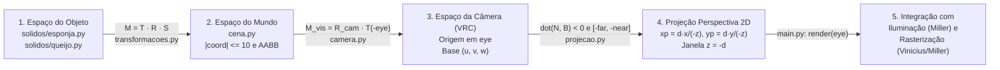

# Plano de Estudo Detalhado — Parte do Matheus (Computação Gráfica 2026.2)

**Instituição:** Instituto Federal de Educação, Ciência e Tecnologia do Ceará (IFCE) – Campus Fortaleza  
**Curso:** Engenharia da Computação | **Disciplina:** Computação Gráfica (2026.2)  
**Professor:** Prof. Dr. Ajalmar Rocha Neto  
**Integrante Foco deste Guia:** **Matheus** (em equipe com Miller e Vinicius)  

---

## 1. Visão Geral: O que o Trabalho Pede vs. O que Pertence ao Matheus

De acordo com a especificação oficial (<code style="color: #ef4444; font-weight: bold;">docs/Trabalho CG 2026_2.docx-2.pdf</code>), o plano de ação da equipe (<code style="color: #ef4444; font-weight: bold;">docs/plano_de_acao_trabalho_CG.md</code>) e o relatório técnico final (<code style="color: #ef4444; font-weight: bold;">docs/relatorio_trabalho_cg.pdf</code>), **Matheus é responsável por todo o núcleo geométrico 3D$\to$2D do pipeline e pela orquestração principal do projeto** (totalizando 10 dos 30 pontos da divisão equilibrada):

| Tópico do Edital (<code style="color: #ef4444; font-weight: bold;">docs/Trabalho CG 2026_2.docx-2.pdf</code>) | Tarefa do Matheus (<code style="color: #ef4444; font-weight: bold;">docs/plano_de_acao_trabalho_CG.md</code>) | Arquivos e Funções no Código | Evidência no Relatório (<code style="color: #ef4444; font-weight: bold;">docs/relatorio_trabalho_cg.pdf</code>) |
| :--- | :--- | :--- | :--- |
| **Item 1 (a–e):** Modelar 5 objetos do cotidiano em malha de triângulos com normais externas e exibir no sistema do objeto | Modelar a **Esponja de lavar louça** (1 pt) e a **Fatia de queijo** (1 pt), além do contrato de dados em <code style="color: #ef4444; font-weight: bold;">solidos/__init__.py</code> | <code style="color: #ef4444; font-weight: bold;">solidos/esponja.py</code> (`criar_esponja`)<br><code style="color: #ef4444; font-weight: bold;">solidos/queijo.py</code> (`criar_queijo`)<br><code style="color: #ef4444; font-weight: bold;">visualizacao_3d.py</code> (`plotar_solidos_isolados`) | **Seção 3.1**, **Tabela 1** e **Figura 1 (Item 1e)** |
| **Item 2 (a–b):** Compor a cena no sistema do mundo sem sobreposição/interseção, usando escala, rotação e translação com $\|x\|, \|y\|, \|z\| \le 10$ | Implementar as matrizes homogêneas $4\times 4$ e montar/validar a cena com caixas delimitadoras (AABBs) (2 pts) | <code style="color: #ef4444; font-weight: bold;">transformacoes.py</code> (`escala`, `rotacao_x/y/z`, `translacao`, `aplicar_transformacao`, `transformar_solido`)<br><code style="color: #ef4444; font-weight: bold;">cena.py</code> (`montar_cena`, `obter_bounding_box`, `verificar_intersecao_aabb`, `validar_cena`) | **Seção 3.2**, **Tabela 2** e **Figura 2 (Item 2b)** |
| **Item 3 (a–e):** Escolher `eye`, computar base vetorial $(u,v,w)$, transformar mundo$\to$câmera, marcar origem do mundo e variar `eye` | Construir o sistema de coordenadas de visão (VRC), matriz $M_{\text{vis}} = R \cdot T(-\text{eye})$ e transformação de vértices/normais (2 pts) | <code style="color: #ef4444; font-weight: bold;">camera.py</code> (`camera`, `transformar_para_camera`, `obter_origem_mundo_na_camera`)<br><code style="color: #ef4444; font-weight: bold;">visualizacao_3d.py</code> (`plotar_cena_camera`, `plotar_variacao_eye`) | **Seção 3.3**, **Tabela 3**, **Figura 3 (Itens 3c–3d)** e **Figura 4 (Item 3e)** |
| **Item 4 (e 4a) + pré-requisito do Item 6:** Projeção em perspectiva no volume de visão, descarte de faces ocultas, apresentação 3D + janela 2D | Implementar *Backface Culling* pela normal, recorte *near/far* do frustum, divisão em perspectiva e plot 3D+2D (3 pts) | <code style="color: #ef4444; font-weight: bold;">projecao.py</code> (`descartar_faces_ocultas`, `projetar`)<br><code style="color: #ef4444; font-weight: bold;">visualizacao_pipeline.py</code> (`plotar_projecao_3d_2d`) | **Seção 3.4**, **Tabela 4** e **Figura 5 (Itens 4 e 4a)** |
| **Integração Geral e Entrega (Obs2/Obs4):** Pipeline ponta a ponta, geração das figuras e documentação | Implementar `render(eye)` em <code style="color: #ef4444; font-weight: bold;">main.py</code>, <code style="color: #ef4444; font-weight: bold;">README.md</code> e <code style="color: #ef4444; font-weight: bold;">requirements.txt</code> (1 pt) | <code style="color: #ef4444; font-weight: bold;">main.py</code> (`render`, `gerar_todas_figuras`)<br><code style="color: #ef4444; font-weight: bold;">README.md</code>, <code style="color: #ef4444; font-weight: bold;">requirements.txt</code> | **Figura 8 (Itens 3e e 6)** e reprodutibilidade de todo o relatório |

### Fluxo Geométrico sob Responsabilidade do Matheus



---

## 2. Módulo 1 de Estudo — Modelagem Geométrica: Esponja e Fatia de Queijo (Item 1)

### 2.1 O que o Enunciado Exige no Item 1
- **1a.** Os 5 sólidos escolhidos devem ser únicos por equipe.
- **1b.** Para cada sólido, criar uma **malha de polígonos (triângulos)** usando algoritmo próprio.
- **1c e 1d.** Cada polígono (triângulo) deve ter um **vetor normal à sua superfície que aponta para fora do sólido/objeto**.
- **1e.** Mostrar cada sólido em seu **sistema de coordenadas do objeto**, e criar uma função que retorne o sólido (matriz de vértices, arestas, faces, atributos, etc.).

### 2.2 Base Teórica (Direto ao Ponto)
1. **Malha Triangular e Orientação Anti-Horária (CCW):**
   - Um triângulo no espaço 3D é definido por três índices de vértices $(v_0, v_1, v_2)$.
   - Pela **regra da mão direita**, se olharmos para a face pelo lado de **fora** do objeto e percorremos seus vértices no sentido **anti-horário** (*Counter-Clockwise — CCW*), o produto vetorial das duas arestas que partem de $v_0$ aponta obrigatoriamente **para fora**:
     $$\vec{N} = (v_1 - v_0) \times (v_2 - v_0), \quad \hat{n} = \frac{\vec{N}}{\|\vec{N}\|}$$
   - Se trocarmos a ordem de dois vértices (por exemplo, $[v_0, v_2, v_1]$), o sentido do produto vetorial se inverte ($\vec{N}$ passa a apontar para dentro do sólido).

2. **Como Provar que as Normais Apontam para Fora?**
   - **Teste do Produto Escalar Externo (para sólidos convexos centrados próximos à origem):** Se $C$ é o centroide do sólido e $B_f = \frac{v_0 + v_1 + v_2}{3}$ é o baricentro da face $f$, o vetor $(B_f - C)$ aponta do centro do objeto para a face. Logo, a normal $\hat{n}_f$ aponta para fora se e somente se:
     $$(B_f - C) \cdot \hat{n}_f > 0 \quad \forall f$$
   - **Teste Geral pelo Teorema da Divergência (Volume Assinado):** Para qualquer malha triangular fechada (*watertight*), o volume assinado é:
     $$V = \frac{1}{6} \sum_{f} v_0 \cdot (v_1 \times v_2)$$
     Se todas as faces estão orientadas CCW para fora, então $V > 0$.

---

### 2.3 Foco na Prática: Como Foi Implementado no Código

#### A. O Contrato Padrão do Dicionário do Sólido (<code style="color: #ef4444; font-weight: bold;">solidos/__init__.py#L1-L27</code>)
Para que todos os módulos da equipe conversassem sem acoplamento, todas as funções `criar_<solido>()` retornam exatamente a mesma estrutura:
```python
{
    "vertices": np.ndarray,      # shape (N, 3), dtype float64 — coordenadas (x, y, z)
    "faces": np.ndarray,         # shape (M, 3), dtype int32   — triplas [i0, i1, i2] em ordem CCW
    "arestas": np.ndarray,       # shape (K, 2), dtype int32   — pares únicos [u, v] com u < v
    "normais_faces": np.ndarray, # shape (M, 3), dtype float64 — vetores unitários apontando para fora
    "cor": tuple[float, float, float], # (r, g, b) em [0.0, 1.0]
    "nome": str                  # "esponja", "queijo", etc.
}
```

#### B. Modelagem da Esponja (<code style="color: #ef4444; font-weight: bold;">solidos/esponja.py#L9-L80</code>)
- **Geometria:** Um paralelepípedo reto centrado na origem $(0,0,0)$ do sistema do objeto, com dimensões padrão `largura = 3.0` (eixo $X$), `altura = 1.2` (eixo $Y$) e `profundidade = 2.0` (eixo $Z$), e cor amarelo-esverdeada `(0.85, 0.85, 0.15)`.
- **Passo 1 — Geração dos 8 Vértices (linhas 24–38):**
  Calculamos as meias-dimensões `hx = largura / 2.0`, `hy = altura / 2.0` e `hz = profundidade / 2.0`:
  - Índices `0, 1, 2, 3`: plano traseiro ($z = -h_z$), percorrendo a volta no plano $XY$.
  - Índices `4, 5, 6, 7`: plano frontal ($z = +h_z$), na mesma disposição $(x, y)$.
  ```python
  vertices = np.array([
      [-hx, -hy, -hz],  # 0: traseiro inferior esquerdo
      [ hx, -hy, -hz],  # 1: traseiro inferior direito
      [ hx,  hy, -hz],  # 2: traseiro superior direito
      [-hx,  hy, -hz],  # 3: traseiro superior esquerdo
      [-hx, -hy,  hz],  # 4: frontal inferior esquerdo
      [ hx, -hy,  hz],  # 5: frontal inferior direito
      [ hx,  hy,  hz],  # 6: frontal superior direito
      [-hx,  hy,  hz],  # 7: frontal superior esquerdo
  ], dtype=np.float64)
  ```
- **Passo 2 — Triangulação CCW das 6 Faces Retangulares = 12 Triângulos (linhas 41–54):**
  Cada face retangular da caixa é dividida em 2 triângulos. **Ponto crucial para explicar na apresentação:**
  - Na **face frontal** ($z = +h_z$), quem olha de fora está em $z > +h_z$ olhando na direção $-Z$. Os vértices `4 -> 5 -> 6 -> 7` estão em sentido anti-horário. Por isso os triângulos são `[4, 5, 6]` e `[4, 6, 7]`.
    - Teste rápido: $(v_5 - v_4) = (2h_x, 0, 0)$ e $(v_6 - v_4) = (2h_x, 2h_y, 0)$. O produto vetorial $(2h_x, 0, 0) \times (2h_x, 2h_y, 0) = (0, 0, 4h_x h_y)$, que normalizado dá $(0, 0, +1)$ — apontando para fora ($+Z$)!
  - Na **face traseira** ($z = -h_z$), quem olha de fora está em $z < -h_z$ olhando na direção $+Z$. Se usássemos `[0, 1, 2]`, a normal apontaria para $+Z$ (para **dentro** da esponja!). Por isso invertemos a ordem para `[0, 2, 1]` e `[0, 3, 2]`, produzindo normal $(0, 0, -1)$ — apontando para fora ($-Z$)!
- **Passo 3 — Extração das 18 Arestas Únicas (linhas 57–62):**
  Cada um dos 12 triângulos tem 3 lados ($12 \times 3 = 36$ meia-arestas), mas como cada aresta é compartilhada por 2 triângulos adjacentes, existem $36 / 2 = 18$ arestas únicas (12 arestas do cubo + 6 diagonais das faces). O código usa um `set` com `tuple(sorted((f[i], f[(i + 1) % 3])))` para eliminar duplicatas independentemente do sentido $(u,v)$ ou $(v,u)$:
  ```python
  arestas_set = set()
  for f in faces:
      for i in range(3):
          e = tuple(sorted((f[i], f[(i + 1) % 3])))
          arestas_set.add(e)
  arestas = np.array(sorted(list(arestas_set)), dtype=np.int32)
  ```
- **Passo 4 — Cálculo Vetorizado das Normais Unitárias (linhas 65–70):**
  Em vez de fazer um `for` em Python sobre cada face, indexamos todos os triângulos de uma só vez via NumPy:
  ```python
  v0 = vertices[faces[:, 0]]  # (12, 3)
  v1 = vertices[faces[:, 1]]  # (12, 3)
  v2 = vertices[faces[:, 2]]  # (12, 3)
  normais = np.cross(v1 - v0, v2 - v0)
  normas = np.linalg.norm(normais, axis=1, keepdims=True)
  normais_unitarias = normais / np.where(normas == 0, 1.0, normas)
  ```

#### C. Modelagem da Fatia de Queijo (<code style="color: #ef4444; font-weight: bold;">solidos/queijo.py#L9-L81</code>)
- **Geometria:** Um prisma triangular em formato de cunha circular (fatia de queijo) de raio $r = 2.5$, abertura angular $\theta = 45^\circ$ ($\pi/4\text{ rad}$) e altura $h = 1.2$ ($y \in [-h/2, +h/2]$).
- **Passo 1 — Geração dos 6 Vértices (linhas 21–42):**
  No plano $XZ$, a fatia tem o bico na origem $(0,0)$, uma borda alinhada ao eixo $+X$ em $(x_1, z_1) = (r, 0)$ e outra borda rotacionada de $\theta$ em $(x_2, z_2) = (r\cos\theta, r\sin\theta)$:
  - Base inferior ($y = -h_y$): vértices `0` $(0, -h_y, 0)$, `1` $(x_1, -h_y, 0)$ e `2` $(x_2, -h_y, z_2)$.
  - Base superior ($y = +h_y$): vértices `3` $(0, +h_y, 0)$, `4` $(x_1, +h_y, 0)$ e `5` $(x_2, +h_y, z_2)$.
- **Passo 2 — Triangulação CCW das 8 Faces (linhas 45–56):**
  Um prisma triangular possui 2 bases triangulares e 3 faces laterais retangulares ($2 \times 1 + 3 \times 2 = 8$ triângulos e $12$ arestas):
  - **Base inferior (`[0, 1, 2]`):** Em $y = -h_y$, como $z_2 > 0$, $(v_1 - v_0) \times (v_2 - v_0) = (r, 0, 0) \times (r\cos\theta, 0, r\sin\theta) = (0, -r^2\sin\theta, 0)$, que normalizado dá $(0, -1, 0)$ (aponta para baixo, para fora!).
  - **Base superior (`[3, 5, 4]`):** Ordem invertida em relação à base inferior para que o produto vetorial dê $(0, +1, 0)$ (aponta para cima, para fora!).
  - **Lateral reta 1 (plano $z = 0$, vértices `0, 1, 4, 3`):** Triângulos `[0, 4, 1]` e `[0, 3, 4]`, cuja normal aponta para $(0, 0, -1)$.
  - **Lateral reta 2 (plano inclinado de $\theta$, vértices `0, 2, 5, 3`):** Triângulos `[0, 5, 3]` e `[0, 2, 5]`, cuja normal aponta para $(-\sin\theta, 0, \cos\theta)$.
  - **Casca externa do queijo (entre `1, 2, 5, 4`):** Triângulos `[1, 5, 2]` e `[1, 4, 5]`, com normal apontando radialmente para fora da fatia.

#### D. Exibição no Sistema do Objeto — Item 1e (<code style="color: #ef4444; font-weight: bold;">visualizacao_3d.py#L78-L188</code>)
- A função `plotar_solido_3d` (linhas 78–125) desenha os triângulos com `Poly3DCollection` e plota as setas das normais saindo do baricentro de cada face (`centroides = (v0 + v1 + v2) / 3.0`) usando `ax.quiver(..., length=0.45, normalize=True)`.
- A função `plotar_solidos_isolados` (linhas 128–188) gera a **Figura 1** do relatório (<code style="color: #ef4444; font-weight: bold;">outputs/fig_1e_solidos_isolados.png</code>) com os 5 objetos em seus referenciais locais `X_obj, Y_obj, Z_obj` e escala cúbica `1:1:1` (`_configurar_limites_cubicos`).

---

## 3. Módulo 2 de Estudo — Transformações 4×4 e Cena no Mundo (Item 2)

### 3.1 O que o Enunciado Exige no Item 2
- **2 (caput):** Compor uma cena contendo os 5 sólidos modelados anteriormente em um sistema de coordenadas do mundo, **de tal maneira a não haver sobreposição ou intersecção entre tais objetos**, usando transformações em **escala, rotação e translação**.
- **2a.** O maior valor possível para cada uma das componentes de um vértice deve ser igual a $|10|$ ($|x|, |y|, |z| \le 10$). Se necessário, aplicar transformações em escala.
- **2b.** Mostrar os diversos sólidos neste sistema de coordenadas em 3D.

### 3.2 Base Teórica
1. **Coordenadas Homogêneas e Matrizes $4\times 4$:**
   - Em $\mathbb{R}^3$, escala e rotação são transformações lineares ($3\times 3$), mas a **translação** ($p' = p + t$) é uma transformação afim (não pode ser escrita como multiplicação por matriz $3\times 3$).
   - Ao representar um ponto 3D em **coordenadas homogêneas** como vetor coluna de 4 dimensões $p_{\text{hom}} = [x, y, z, 1]^T$, todas as transformações elementares tornam-se matrizes $4\times 4$:
     $$S(s_x, s_y, s_z) = \begin{bmatrix} s_x & 0 & 0 & 0 \\ 0 & s_y & 0 & 0 \\ 0 & 0 & s_z & 0 \\ 0 & 0 & 0 & 1 \end{bmatrix}, \quad T(t_x, t_y, t_z) = \begin{bmatrix} 1 & 0 & 0 & t_x \\ 0 & 1 & 0 & t_y \\ 0 & 0 & 1 & t_z \\ 0 & 0 & 0 & 1 \end{bmatrix}$$
     $$R_y(\theta) = \begin{bmatrix} \cos\theta & 0 & \sin\theta & 0 \\ 0 & 1 & 0 & 0 \\ -\sin\theta & 0 & \cos\theta & 0 \\ 0 & 0 & 0 & 1 \end{bmatrix} \quad (\text{e analogamente } R_x(\theta), R_z(\theta))$$
2. **Ordem de Composição $M = T \cdot R \cdot S$:**
   - Como multiplicamos o vetor coluna à direita ($p' = M \cdot p = T \cdot (R \cdot (S \cdot p))$):
     1. Primeiro **Escala ($S$)** redimensiona o objeto ainda centrado na sua própria origem local;
     2. Depois **Rotação ($R$)** gira o objeto em torno da sua própria origem local;
     3. Por fim **Translação ($T$)** desloca o objeto já dimensionado e orientado para sua posição final no mundo.
   - *(Atenção para a apresentação: se fizéssemos $R \cdot T$, a translação ocorreria primeiro e a rotação giraria o objeto em órbita ao redor da origem do mundo!)*
3. **Como Ficam as Normais após Transformar o Sólido?**
   - Se um sólido sofre uma escala não-uniforme ($s_x \neq s_y \neq s_z$), multiplicar a normal diretamente pela matriz $M$ distorce o ângulo e ela deixa de ser perpendicular à superfície (seria necessário multiplicar pela inversa transposta $(M_{3\times 3}^{-1})^T$).
   - **Solução elegante adotada no código:** Após transformar todos os vértices para o mundo, **recalculamos as normais diretamente a partir dos novos vértices das faces** com $(v'_1 - v'_0) \times (v'_2 - v'_0)$. Como $\det(M_{3\times 3}) > 0$ (escalas positivas e rotações próprias), a orientação CCW é preservada e a normal recalculada é garantidamente perpendicular à face transformada!
4. **Verificação de Não-Interseção por AABB (*Axis-Aligned Bounding Box*):**
   - A caixa delimitadora alinhada aos eixos de um sólido é definida por $p_{\min} = (\min X, \min Y, \min Z)$ e $p_{\max} = (\max X, \max Y, \max Z)$.
   - Duas AABBs $A$ e $B$ se interceptam se e somente se houver superposição de intervalos nos **três eixos simultaneamente**:
     $$(\min_{A,x} \le \max_{B,x} \land \max_{A,x} \ge \min_{B,x}) \land (\min_{A,y} \le \max_{B,y} \land \max_{A,y} \ge \min_{B,y}) \land (\min_{A,z} \le \max_{B,z} \land \max_{A,z} \ge \min_{B,z})$$

---

### 3.3 Foco na Prática: Como Foi Implementado no Código

#### A. Módulo de Transformações (<code style="color: #ef4444; font-weight: bold;">transformacoes.py#L9-L103</code>)
- **Matrizes $4\times 4$ (linhas 9–62):** `escala(sx, sy, sz)`, `rotacao_x(theta)`, `rotacao_y(theta)`, `rotacao_z(theta)` e `translacao(tx, ty, tz)`.
- **Aplicação Vetorizada em Lote (`aplicar_transformacao`, linhas 65–77):**
  Em vez de multiplicar vértice por vértice num laço, convertemos a matriz de vértices `(N, 3)` para `(N, 4)` adicionando uma coluna de `1.0` com `np.hstack`, aplicamos `(matriz @ homogeneos.T).T` e dividimos pelas coordenadas homogêneas $w$:
  ```python
  def aplicar_transformacao(vertices: np.ndarray, matriz: np.ndarray) -> np.ndarray:
      n = len(vertices)
      homogeneos = np.hstack([vertices, np.ones((n, 1), dtype=np.float64)])  # (N, 4)
      transformados = (matriz @ homogeneos.T).T                              # (N, 4)
      w = transformados[:, 3:4]
      w = np.where(np.abs(w) < 1e-9, 1.0, w)
      return transformados[:, :3] / w
  ```
- **Transformação do Sólido Completo (`transformar_solido`, linhas 80–102):**
  Transforma `solido["vertices"]` e recalcula `normais_faces` unitárias a partir de `novos_vertices[faces]`.

#### B. Montagem e Validação da Cena (<code style="color: #ef4444; font-weight: bold;">cena.py#L24-L98</code>)
- **Posicionamento dos 5 Objetos em `montar_cena()` (linhas 40–78):**
  Os 5 objetos são distribuídos em regiões bem separadas do cubo $[-10, 10]^3$, combinando escala, rotações nos 3 eixos ($R_x, R_y, R_z$) e translações:
  ```python
  # 1. Esponja - quadrante superior esquerdo (usa T @ Ry @ S)
  esponja = criar_esponja(largura=2.6, altura=1.0, profundidade=1.8, cor=(0.85, 0.85, 0.15))
  m_esponja = translacao(-6.0, 5.0, -2.0) @ rotacao_y(np.radians(20)) @ escala(1.15, 1.2, 1.1)
  esponja_mundo = transformar_solido(esponja, m_esponja)

  # 2. Fatia de queijo - quadrante inferior esquerdo (usa T @ Ry)
  queijo = criar_queijo(raio=2.2, angulo_graus=50.0, altura=1.0, cor=(1.0, 0.65, 0.0))
  m_queijo = translacao(-6.0, -4.0, 2.0) @ rotacao_y(np.radians(45))
  queijo_mundo = transformar_solido(queijo, m_queijo)

  # 3. Prato - centro inferior (usa T)
  prato = criar_prato(raio_base=1.2, raio_borda=2.4, altura=0.6, num_fatias=24, cor=(0.95, 0.95, 0.98))
  m_prato = translacao(0.0, -4.0, 0.0)
  prato_mundo = transformar_solido(prato, m_prato)

  # 4. Rolo de massa - centro superior (usa T @ Rz)
  rolo = criar_rolo(raio_rolo=0.7, comp_rolo=2.8, raio_haste=0.25, comp_haste=0.8, cor=(0.76, 0.58, 0.40))
  m_rolo = translacao(0.0, 5.0, 0.0) @ rotacao_z(np.radians(15))
  rolo_mundo = transformar_solido(rolo, m_rolo)

  # 5. Boia de piscina - lado direito (usa T @ Rx)
  boia = criar_boia(R=1.8, r=0.6, n_u=20, n_v=14, cor=(0.1, 0.7, 0.9))
  m_boia = translacao(6.0, 0.0, 0.0) @ rotacao_x(np.radians(70))
  boia_mundo = transformar_solido(boia, m_boia)
  ```
- **Trava Automática de Validação (`validar_cena`, linhas 81–98):**
  Logo antes de retornar a lista `cena`, `montar_cena()` chama `validar_cena(cena)`, que executa dois `assert` rigorosos:
  1. **Limite espacial (Item 2a):** `max_coord = np.max(np.abs(v))` $\implies$ `assert max_coord <= 10.0` (o maior valor real na cena é `8.40` na extremidade direita da boia, conforme a **Tabela 2** do relatório).
  2. **Ausência de colisão para todos os 10 pares de objetos:** Duplo loop `for i in range(n): for j in range(i + 1, n):` testando `assert not verificar_intersecao_aabb(box_a, box_b)`.

---

## 4. Módulo 3 de Estudo — Sistema de Coordenadas da Câmera / VRC (Item 3)

### 4.1 O que o Enunciado Exige no Item 3
- **3 (caput):** Escolher um ponto (`eye`) como origem para o sistema de coordenadas da câmera.
- **3a.** Computar a base vetorial do novo sistema de coordenadas.
- **3b.** Transformar os objetos do sistema de coordenadas do mundo para o sistema de coordenadas da câmera.
- **3c.** Mostrar os diversos sólidos neste sistema de coordenadas em 3D.
- **3d.** Colocar um ponto informando a origem do sistema de coordenadas do mundo.
- **3e.** O valor de `eye` pode mudar e, portanto, uma nova imagem deve ser gerada.

### 4.2 Base Teórica
1. **Construção da Base Ortonormal Dextrógira $(u, v, w)$:**
   Dados três parâmetros no sistema do mundo:
   - $\text{eye}$: posição da câmera (nova origem $(0,0,0)_{\text{cam}}$);
   - $\text{at}$: ponto alvo para onde a câmera olha (padrão $(0,0,0)_{\text{mundo}}$);
   - $\text{up}$: vetor indicando a direção vertical "para cima" do mundo (padrão $(0,1,0)$).

   Construímos os três eixos unitários e mutuamente ortogonais:
   - **Eixo $\vec{w}$ ($+Z_{\text{cam}}$):** Aponta do alvo $\text{at}$ para a câmera $\text{eye}$ (isto é, para **trás** da câmera, de modo que a câmera olha ao longo de $-\vec{w}$, ou seja, $z_{\text{cam}} < 0$):
     $$\vec{w} = \frac{\text{eye} - \text{at}}{\|\text{eye} - \text{at}\|}$$
   - **Eixo $\vec{u}$ ($+X_{\text{cam}}$, direita da câmera):** Perpendicular tanto ao vetor $\text{up}$ quanto a $\vec{w}$:
     $$\vec{u} = \frac{\text{up} \times \vec{w}}{\|\text{up} \times \vec{w}\|}$$
   - **Eixo $\vec{v}$ ($+Y_{\text{cam}}$, topo real da câmera):** Perpendicular a $\vec{w}$ e $\vec{u}$ (como $\vec{w}$ e $\vec{u}$ já são unitários e ortogonais, $\vec{v}$ já nasce unitário):
     $$\vec{v} = \vec{w} \times \vec{u}$$

2. **Por que a Matriz de Visão é $M_{\text{vis}} = R \cdot T(-\text{eye})$ com $u, v, w$ nas LINHAS de $R$?**
   - **Pergunta clássica da apresentação!** Para levar um ponto $P_{\text{mundo}}$ para o referencial da câmera:
     1. Primeiro subtraímos a posição da câmera: $P_{\text{desloc}} = P_{\text{mundo}} - \text{eye}$, o que equivale à matriz de translação $T(-\text{eye})$. Agora a câmera está na origem.
     2. Em seguida, queremos saber quais são as componentes desse vetor $P_{\text{desloc}}$ ao longo dos novos eixos unitários $\vec{u}, \vec{v}, \vec{w}$. Pela álgebra linear, a coordenada de um vetor em uma base ortonormal é simplesmente o **produto escalar** do vetor por cada vetor da base:
        $$x_{\text{cam}} = \vec{u} \cdot P_{\text{desloc}}, \quad y_{\text{cam}} = \vec{v} \cdot P_{\text{desloc}}, \quad z_{\text{cam}} = \vec{w} \cdot P_{\text{desloc}}$$
     3. Escrevendo esses três produtos escalares em forma matricial, os vetores $\vec{u}^T, \vec{v}^T, \vec{w}^T$ ficam exatamente nas **três linhas** da matriz de rotação $R$:
        $$M_{\text{vis}} = R \cdot T(-\text{eye}) = \begin{bmatrix} u_x & u_y & u_z & 0 \\ v_x & v_y & v_z & 0 \\ w_x & w_y & w_z & 0 \\ 0 & 0 & 0 & 1 \end{bmatrix} \begin{bmatrix} 1 & 0 & 0 & -\text{eye}_x \\ 0 & 1 & 0 & -\text{eye}_y \\ 0 & 0 & 1 & -\text{eye}_z \\ 0 & 0 & 0 & 1 \end{bmatrix}$$

3. **Qual é a Posição da Origem do Mundo $(0,0,0)_{\text{mundo}}$ Vista pela Câmera (Item 3d)?**
   - Quando a câmera olha diretamente para a origem do mundo ($\text{at} = (0,0,0)$), o vetor da câmera até a origem do mundo é $-\text{eye} = -\|\text{eye}\|\vec{w}$.
   - Como $\vec{u} \perp \vec{w}$ e $\vec{v} \perp \vec{w}$, ao aplicar $M_{\text{vis}}$ sobre $(0,0,0,1)^T$, obtemos:
     $$O_{\text{mundo na câmera}} = \left(0,\; 0,\; -\|\text{eye}\|\right)$$
   - Exemplo real da **Tabela 3** do relatório: para $\text{eye} = (12, 8, 14)$, temos $\|\text{eye}\| = \sqrt{12^2 + 8^2 + 14^2} = \sqrt{144 + 64 + 196} = \sqrt{404} \approx 20,10$. Logo, a origem do mundo aparece exatamente em $(0,00,\; 0,00,\; -20,10)$ no eixo $-Z_{\text{cam}}$!

---

### 4.3 Foco na Prática: Como Foi Implementado no Código (<code style="color: #ef4444; font-weight: bold;">camera.py#L10-L96</code>)

#### A. Cálculo da Base e da Matriz de Visão (`camera`, linhas 10–67)
```python
def camera(eye, at=(0.0, 0.0, 0.0), up=(0.0, 1.0, 0.0)):
    eye_arr = np.array(eye, dtype=np.float64)
    at_arr = np.array(at, dtype=np.float64)
    up_arr = np.array(up, dtype=np.float64)

    # 1. Vetor w (eixo Z da câmera, aponta de at para eye)
    w_vec = eye_arr - at_arr
    norm_w = np.linalg.norm(w_vec)
    if norm_w == 0:
        raise ValueError("eye e at não podem coincidir.")
    w = w_vec / norm_w

    # 2. Vetor u (eixo X da câmera = up x w normalizado)
    u_vec = np.cross(up_arr, w)
    norm_u = np.linalg.norm(u_vec)
    if norm_u == 0:
        raise ValueError("Vetor up não pode ser paralelo à linha de visão.")
    u = u_vec / norm_u

    # 3. Vetor v (eixo Y da câmera = w x u)
    v = np.cross(w, u)

    # 4. Matriz R (u, v, w nas linhas) e T (-eye)
    R = np.array([
        [u[0], u[1], u[2], 0.0],
        [v[0], v[1], v[2], 0.0],
        [w[0], w[1], w[2], 0.0],
        [ 0.0,  0.0,  0.0, 1.0],
    ], dtype=np.float64)

    T = np.array([
        [1.0, 0.0, 0.0, -eye_arr[0]],
        [0.0, 1.0, 0.0, -eye_arr[1]],
        [0.0, 0.0, 1.0, -eye_arr[2]],
        [0.0, 0.0, 0.0,         1.0],
    ], dtype=np.float64)

    matriz_visao = R @ T
    return u, v, w, matriz_visao
```

#### B. Transformação dos Sólidos e Normais para a Câmera (`transformar_para_camera`, linhas 70–89)
- Os **vértices** sofrem rotação e translação via `aplicar_transformacao(solido["vertices"], matriz_visao)`.
- As **normais das faces** são vetores direcionais (não sofrem translação!). Por isso extraímos apenas a submatriz ortogonal $3\times 3$ `R3x3 = matriz_visao[:3, :3]` e rotacionamos as normais:
  ```python
  R3x3 = matriz_visao[:3, :3]
  normais_cam = (R3x3 @ solido["normais_faces"].T).T
  ```

#### C. Marcação da Origem do Mundo e Variação de `eye` (`obter_origem_mundo_na_camera` e <code style="color: #ef4444; font-weight: bold;">visualizacao_3d.py</code>)
- `obter_origem_mundo_na_camera(matriz_visao)` (linhas 92–95) passa `np.array([[0.0, 0.0, 0.0]])` por `aplicar_transformacao(..., matriz_visao)[0]`.
- Em <code style="color: #ef4444; font-weight: bold;">visualizacao_3d.py#L234-L439</code>, `_desenhar_cena_na_camera` plota:
  - A **origem da câmera** em `(0, 0, 0)` com um triângulo preto (`marker="^"`).
  - A **origem do mundo transformada** com uma estrela vermelha (`marker="*"`) e caixa de anotação indicando suas coordenadas na câmera.
- `plotar_variacao_eye` gera a **Figura 4 (Item 3e)** comparando três posições de `eye`:
  1. `eye = (12.0, 8.0, 14.0)` (visão diagonal frontal direita);
  2. `eye = (-12.0, 8.0, 14.0)` (visão diagonal frontal esquerda — note na Tabela 3 como $u_z$ e $w_x$ invertem de sinal!);
  3. `eye = (0.0, 14.0, 16.0)` (visão central elevada — onde $u = (1, 0, 0)$ fica perfeitamente alinhado ao eixo $X$ do mundo).

---

## 5. Módulo 4 de Estudo — Projeção em Perspectiva, Backface Culling e Clipping (Item 4 e 4a)

### 5.1 O que o Enunciado Exige no Item 4 (e no início do Item 6)
- **4 (caput):** Fazer uma transformação de projeção em perspectiva dos sólidos contidos no volume de visão e projetar os sólidos (polígono a polígono) em 2 dimensões na janela de projeção. **Os polígonos que não são visíveis não devem ser trazidos para o plano de projeção.** Cada sólido deve conter arestas e faces com mesma cor, mas sólidos diferentes devem ter cores diferentes.
- **4a.** Apresentar tais objetos em 2D na janela de projeção (**o espaço é em 3D, mas tem tanto os objetos em 3D quanto as projeções na janela de projeção**).
- **6 (pré-requisito):** *"Antes de rasterizar, elimine os polígonos que estão ocultos usando a informação da normal à superfície do polígono e o eixo z da câmera."*

### 5.2 Base Teórica
1. **Remoção de Faces Ocultas (*Backface Culling* no Espaço da Câmera):**
   - No sistema da câmera, o observador (olho) está na origem $O_{\text{cam}} = (0,0,0)$.
   - Considere uma face triangular com vértices $v_0, v_1, v_2$ e baricentro $B = \frac{v_0 + v_1 + v_2}{3}$.
   - O vetor de visão que parte do olho da câmera até o centro da face é $\vec{d}_{\text{olho}} = B - (0,0,0) = B$.
   - Uma face está **voltada para a câmera (visível)** quando sua normal externa $\hat{n}$ aponta "contra" o raio de visão $\vec{d}_{\text{olho}}$ (ângulo $> 90^\circ$), ou seja:
     $$\hat{n} \cdot B < 0 \implies \text{Face Visível}$$
     $$\hat{n} \cdot B \ge 0 \implies \text{Face Traseira/Oculta (Descartada!)}$$
   - *(Por que usar o produto escalar com o baricentro $B$ em vez de olhar apenas para $n_z > 0$? Porque em projeção **perspectiva** os raios de visão formam um feixe cônico que diverge da origem $(0,0,0)$! Testar $\hat{n} \cdot B < 0$ é a condição exata em perspectiva para qualquer inclinação lateral do objeto no frustum, enquanto $n_z > 0$ é uma aproximação ortográfica ao longo do eixo $Z_{\text{cam}}$).*

2. **Volume de Visão (*Frustum Clipping Near/Far*):**
   - Como a câmera olha no sentido $-Z_{\text{cam}}$ ($-\vec{w}$), objetos à frente da câmera possuem coordenada $z_{\text{cam}} < 0$.
   - Definimos dois planos de corte perpendiculares ao eixo óptico:
     - Plano próximo (**near**): $z_{\text{cam}} = -\text{near}$ (com $\text{near} = 0,5 > 0$);
     - Plano distante (**far**): $z_{\text{cam}} = -\text{far}$ (com $\text{far} = 100,0 > \text{near}$).
   - Um triângulo está contido na faixa de profundidade do volume de visão se todos os seus 3 vértices satisfazem:
     $$-\text{far} \le z_{\text{cam}} \le -\text{near}$$
   - Isso impede dois problemas graves: projetar objetos que estão **atrás da câmera** ($z_{\text{cam}} \ge 0$) e **dividir por zero** quando $z_{\text{cam}} \to 0$.

3. **Divisão em Perspectiva (*Pinhole Camera* com Plano de Projeção em $z_{\text{cam}} = -d$):**
   - Colocando a janela de projeção à distância $d > 0$ à frente da câmera (no plano $z_{\text{cam}} = -d$, onde no projeto usamos $d = 1,8$), um raio que sai de $(x, y, z)$ até a origem $(0,0,0)$ intercepta o plano $z_{\text{cam}} = -d$.
   - Por semelhança de triângulos (já que a distância de $(x,y,z)$ ao plano $XY$ da câmera é $-z > 0$):
     $$\frac{x_p}{d} = \frac{x}{-z} \implies x_p = \frac{d \cdot x}{-z}, \qquad \frac{y_p}{d} = \frac{y}{-z} \implies y_p = \frac{d \cdot y}{-z}$$
   - Quanto mais distante o objeto (maior $-z$), menor fica sua projeção $(x_p, y_p)$ — reproduzindo o encurtamento perspectivo real!

---

### 5.3 Foco na Prática: Como Foi Implementado no Código (<code style="color: #ef4444; font-weight: bold;">projecao.py#L9-L87</code>)

#### A. Backface Culling (`descartar_faces_ocultas`, linhas 9–33)
```python
def descartar_faces_ocultas(solido_cam: dict) -> np.ndarray:
    vertices = solido_cam["vertices"]
    faces = solido_cam["faces"]
    normais = solido_cam["normais_faces"]

    # Baricentros das M faces no espaço da câmera: shape (M, 3)
    baricentros = (vertices[faces[:, 0]] + vertices[faces[:, 1]] + vertices[faces[:, 2]]) / 3.0
    direcao_olho = baricentros  # Vetor de (0,0,0) até o baricentro

    # Produto escalar linha a linha: N · B
    dots = np.sum(normais * direcao_olho, axis=1)

    # Mantém apenas os índices onde dot < 0
    indices_visiveis = np.where(dots < 0.0)[0]
    return indices_visiveis
```

#### B. Projeção e Recorte de Frustum (`projetar`, linhas 36–86)
```python
def projetar(solido_cam: dict, d: float = 1.0, near: float = 0.5, far: float = 100.0):
    if near <= 0.0:
        raise ValueError(f"O plano near deve ser positivo (> 0), recebido: {near}.")
    if far <= near:
        raise ValueError(f"O plano far deve ser maior que near ({near}), recebido: {far}.")

    vertices = solido_cam["vertices"]
    faces = solido_cam["faces"]

    # 1. Backface culling
    idx_visiveis = descartar_faces_ocultas(solido_cam)
    faces_visiveis = faces[idx_visiveis]

    # 2. Descarte por near/far plane (-far <= z_cam <= -near para os 3 vértices da face)
    z = vertices[:, 2]
    z_faces = z[faces_visiveis]
    mascara_frustum = np.all((z_faces <= -near) & (z_faces >= -far), axis=1)
    faces_visiveis = faces_visiveis[mascara_frustum]

    # 3. Proteção numérica contra divisão por zero e divisão perspectiva
    z_neg = np.where(z < -1e-5, -z, np.nan)
    xp = (d * vertices[:, 0]) / z_neg
    yp = (d * vertices[:, 1]) / z_neg
    pontos_2d = np.column_stack([xp, yp])

    # 4. Garantia extra: nenhuma face visível pode referenciar vértice NaN/Inf
    vertices_finitos = np.all(np.isfinite(pontos_2d), axis=1)
    mascara_finita = np.all(vertices_finitos[faces_visiveis], axis=1)
    faces_visiveis = faces_visiveis[mascara_finita]

    return pontos_2d, faces_visiveis
```
- **Resultado Quantitativo na Cena (Tabela 4 do Relatório):**
  - **Esponja:** 12 faces totais $\to$ **6 visíveis** (50,0% descartadas).
  - **Queijo:** 8 faces totais $\to$ **5 visíveis** (62,5% aproveitadas).
  - **Prato:** 192 faces totais $\to$ **120 visíveis** (62,5% aproveitadas).
  - **Rolo:** 240 faces totais $\to$ **120 visíveis** (50,0% descartadas).
  - **Boia:** 560 faces totais $\to$ **272 visíveis** (48,6% aproveitadas).
  - **Total da Cena:** De **1012 faces**, apenas **523 faces** vão para a janela de projeção e para o rasterizador (**redução de 48,3% no custo computacional**!).

#### C. Figura 5 do Relatório — Espaço 3D + Plano de Projeção + Janela 2D (<code style="color: #ef4444; font-weight: bold;">visualizacao_pipeline.py#L49-L198</code>)
O item **4a** pede algo bem específico: *"Apresente tais objetos em 2D na janela de projeção (o espaço é em 3D, mas tem tanto os objetos em 3D quanto as projeções na janela de projeção)"*.
Veja como `plotar_projecao_3d_2d` resolve isso na **Figura 5** (<code style="color: #ef4444; font-weight: bold;">outputs/fig_4a_projecao_3d_2d.png</code>):
1. **No Subplot Esquerdo (3D no espaço da câmera):**
   - Plota a câmera em `(0, 0, 0)` e a moldura retangular da janela de projeção no plano $z_{\text{cam}} = -1,80$ (`moldura_pts` de $[-1, 1] \times [-1, 1]$ em $z = -d_{\text{proj}}$);
   - Plota os 5 sólidos em 3D nas suas posições reais da câmera ($z_{\text{cam}} \approx -14$ a $-25$);
   - Pega as coordenadas 2D projetadas `pts_2d` das faces visíveis, fixa a terceira coordenada em `z_plano = -1.80` (`pts_plano_3d = np.column_stack([pts_2d, np.full(len(pts_2d), z_plano)])`) e plota os polígonos **achatados diretamente sobre a janela 3D** em $z = -1,80$!
   - Traça linhas tracejadas (`ax_3d.plot([0, pt[0]], [0, pt[1]], [0, pt[2]])`) ligando os vértices dos sólidos 3D até o centro óptico `(0, 0, 0)`, mostrando visualmente os **raios projetantes** atravessando a janela em $z = -1,80$.
2. **No Subplot Direito (Janela 2D):**
   - Exibe o plano 2D $[-1, 1] \times [-1, 1]$ apenas com as faces que sobreviveram ao *Backface Culling* e ao *Frustum Clipping*, com `facecolors` e `edgecolors` da mesma cor por sólido (e cores distintas entre sólidos).

---

## 6. Módulo 5 de Estudo — Orquestração em <code style="color: #ef4444; font-weight: bold;">main.py</code> e Integração com Miller e Vinicius

### 6.1 Como `render(eye)` Conecta Todo o Pipeline (<code style="color: #ef4444; font-weight: bold;">main.py#L32-L133</code>)
Matheus também é responsável pelo <code style="color: #ef4444; font-weight: bold;">main.py</code>, <code style="color: #ef4444; font-weight: bold;">README.md</code> e <code style="color: #ef4444; font-weight: bold;">requirements.txt</code>. Na apresentação, o professor provavelmente pedirá para abrir o <code style="color: #ef4444; font-weight: bold;">main.py</code> e explicar como uma imagem é gerada do início ao fim quando chamamos `render(eye)`:

```python
def render(
    eye=(12.0, 8.0, 14.0),
    at=(0.0, 0.0, 0.0),
    up=(0.0, 1.0, 0.0),
    resolucao=(400, 400),
    d_proj=1.8,
    salvar_caminho=None,
    componente_phong="total",
) -> np.ndarray:
```

**Passo a passo da função `render` (linhas 48–133):**
1. **Alocação dos Buffers em Memória (linhas 55–57):**
   - `buffer_imagem`: matriz `(altura, largura, 3)` inicializada com cinza quase preto `0.05`.
   - `z_buffer`: matriz `(altura, largura)` inicializada com `np.inf` (infinito, pois ainda nenhum pixel foi desenhado).
2. **Etapa 1 & 2 — Mundo (linha 60, Matheus):**
   - `cena_mundo = montar_cena()` cria os 5 sólidos, aplica $M = T \cdot R \cdot S$ e valida $|x|,|y|,|z| \le 10$ e AABBs disjuntas.
3. **Etapa 3 — Câmera (linha 63, Matheus):**
   - `u, v, w, M_vis = camera(eye, at, up)` calcula a base ortonormal e a matriz $4\times 4$ de visão.
4. **Laço sobre cada Sólido da Cena (linhas 68–124):**
   - **Transformação para Câmera (linha 70, Matheus):** `solido_cam = transformar_para_camera(solido_mundo, M_vis)`.
   - **Culling e Projeção Perspectiva (linha 73, Matheus):** `pts_2d, faces_vis = projetar(solido_cam, d=d_proj)`. Se `len(faces_vis) == 0`, pula o sólido.
   - **Iluminação Phong nos Vértices (linhas 78–92, Miller):** Calcula o RGB de cada vértice com `phong(solido_mundo, luz_pos=[0, 10, 5], eye_pos=eye)` (<code style="color: #ef4444; font-weight: bold;">iluminacao.py</code>).
   - **Mapeamento para Viewport/Tela (linhas 97–99, Miller):** Converte `pts_2d` da janela contínua $[-1, 1] \times [-1, 1]$ para coordenadas de pixel $[0, W-1] \times [0, H-1]$ via `mapear_viewport` (<code style="color: #ef4444; font-weight: bold;">rasterizacao.py</code>).
   - **Rasterização Triângulo a Triângulo (linhas 102–124, Vinicius & Miller):**
     Para cada `face` em `faces_vis`:
     - Extrai os 3 vértices em pixels `tri_pts = pts_tela[face]`, as 3 cores `tri_cores = cores_vert[face]` e as **3 profundidades positivas** na câmera `tri_z = -solido_cam["vertices"][face, 2]`.
     - Chama `preencher_par_impar(...)` (varredura scanline par-ímpar + interpolação baricêntrica de cor e profundidade com teste de Z-buffer).
     - Chama `desenhar_arestas_bresenham(...)` com a cor média da face `cor_aresta = np.mean(tri_cores, axis=0)` e teste de Z-buffer.

---

## 7. Roteiro Prático de Estudo e Comandos para Treinar

Para dominar 100% da sua parte antes da apresentação, execute esta sequência no terminal na raiz do projeto:

### Passo 1: Rodar cada um dos seus módulos isoladamente
Cada módulo seu possui um bloco `if __name__ == "__main__":` pronto para demonstração rápida:
```powershell
python solidos/esponja.py
python solidos/queijo.py
python transformacoes.py
python cena.py
python camera.py
python projecao.py
```

### Passo 2: Rodar os testes automatizados da sua parte
```powershell
python -m unittest tests/test_solidos.py -v
python -m unittest tests/test_cena.py -v
python -m unittest tests/test_projecao.py -v
```
- Observe o que cada teste valida:
  - Em <code style="color: #ef4444; font-weight: bold;">tests/test_solidos.py</code>: `test_esponja` e `test_queijo` verificam que todas as normais têm norma 1, que a malha é fechada (toda meia-aresta `(u,v)` tem sua oposta `(v,u)`), que o volume assinado é positivo e que $(B_f - C) \cdot \hat{n}_f > 0$.
  - Em <code style="color: #ef4444; font-weight: bold;">tests/test_cena.py</code>: verifica os 5 sólidos, cores distintas, limite $\le 10$, ausência de colisão AABB e que `validar_cena` lança `AssertionError` se alguém violar o limite de 10 ou sobrepor objetos.
  - Em <code style="color: #ef4444; font-weight: bold;">tests/test_projecao.py</code>: verifica descarte de faces atrás da câmera ($z > 0$), faces em $z = 0$, faces antes do `near`, faces além do `far` e o *backface culling*.

### Passo 3: Testar uma mudança de `eye` ao vivo (Item 3e)
O professor costuma pedir na apresentação: *"Mude a posição da câmera `eye` agora e gere uma nova imagem"*. Treine rodar em uma linha:
```powershell
python -c "from main import render; render(eye=(-10, 12, 15), resolucao=(300, 300), salvar_caminho='outputs/teste_ao_vivo.png')"
```
Ou para regenerar todas as figuras do relatório de uma vez:
```powershell
python main.py --figuras
```

---

## 8. Banco de Perguntas e Respostas para a Apresentação (Foco: Matheus)

Abaixo estão as perguntas mais prováveis que o Prof. Ajalmar pode fazer sobre os seus tópicos e como respondê-las com segurança técnica e citando o código:

### P1. *"Matheus, como você garantiu que as normais da esponja e do queijo apontam todas para fora?"*
> **Resposta:** "Seguindo a regra da mão direita, nós definimos os índices de todos os triângulos em `faces` na ordem **anti-horária (CCW)** quando a face é observada pelo lado externo do sólido. Assim, ao calcular $\vec{N} = (v_1 - v_0) \times (v_2 - v_0)$ com `np.cross(v1 - v0, v2 - v0)` e normalizar, o vetor aponta obrigatoriamente para fora. Além de inspecionar visualmente com as setas do `ax.quiver` na Figura 1 (Item 1e), nós validamos isso matematicamente em <code style="color: #ef4444; font-weight: bold;">tests/test_solidos.py</code> de duas formas: verificando que o produto escalar entre o vetor do centro do sólido até o baricentro da face e a normal é estritamente positivo ($(B_f - C)\cdot \hat{n}_f > 0$), e confirmando que o volume assinado pelo Teorema da Divergência é positivo."

### P2. *"Na esponja (<code style="color: #ef4444; font-weight: bold;">solidos/esponja.py</code>), por que a face frontal é `[4, 5, 6]` e a face traseira é `[0, 2, 1]` em vez de `[0, 1, 2]`?"*
> **Resposta:** "Porque os vértices `0, 1, 2, 3` (em $z = -h_z$) e `4, 5, 6, 7` (em $z = +h_z$) foram numerados na mesma disposição no plano $XY$. Quando olhamos a face frontal de fora (olhando de $+Z$ para $-Z$), a sequência `4 -> 5 -> 6` gira no sentido anti-horário, dando normal $(0, 0, +1)$. Já quando olhamos a face traseira pelo lado de fora do objeto (olhando de $-Z$ para $+Z$), a direção de observação é oposta; se usássemos `0 -> 1 -> 2`, ela seria horária vista de fora e a normal apontaria para dentro $(0, 0, +1)$. Invertendo para `[0, 2, 1]`, ela passa a ser anti-horária vista de trás e a normal resultante é $(0, 0, -1)$, apontando para fora."

### P3. *"Em <code style="color: #ef4444; font-weight: bold;">cena.py</code>, por que você multiplicou as matrizes na ordem `translacao @ rotacao @ escala` ($T \cdot R \cdot S$)?"*
> **Resposta:** "Porque em `aplicar_transformacao` nós multiplicamos a matriz $4\times 4$ à esquerda dos vetores coluna homogêneos ($p' = T \cdot R \cdot S \cdot p$). Dessa forma, a primeira operação aplicada ao vértice é a **escala** $S$ (enquanto o sólido ainda está centrado na origem do seu próprio sistema), depois a **rotação** $R$ (girando o sólido em torno do seu próprio eixo local) e, por último, a **translação** $T$, que leva o objeto já dimensionado e rotacionado para sua posição no mundo. Se invertêssemos para $R \cdot T$, o objeto seria transladado primeiro e a rotação o faria orbitar em torno da origem do mundo."

### P4. *"Quando você aplica uma transformação de escala não-uniforme na esponja (`escala(1.15, 1.2, 1.1)`), o que acontece com as normais?"*
> **Resposta:** "Sob escala não-uniforme, se multiplicássemos os vetores normais diretamente pela matriz $M$, eles deixariam de ser ortogonais às faces (seria preciso usar a inversa transposta $(M_{3\times 3}^{-1})^T$). Em `transformar_solido` (<code style="color: #ef4444; font-weight: bold;">transformacoes.py#L80-L102</code>), nós resolvemos isso de forma direta e exata: aplicamos a matriz $4\times 4$ aos vértices e, em seguida, recalculamos as normais das faces fazendo novamente o produto vetorial $(v'_1 - v'_0) \times (v'_2 - v'_0)$ com os vértices já transformados."

### P5. *"Como você provou que nenhum objeto invade o espaço do outro na cena e que nenhum vértice passa de $|10|$?"*
> **Resposta:** "Em <code style="color: #ef4444; font-weight: bold;">cena.py#L81-L98</code>, a função `validar_cena` é executada automaticamente dentro de `montar_cena()`. Primeiro, ela calcula `np.max(np.abs(v))` para cada sólido e faz `assert max_coord <= 10.0` (o máximo real da nossa cena é $8,40$, na boia). Segundo, ela extrai a *Axis-Aligned Bounding Box* (AABB) de cada sólido com `obter_bounding_box` e testa todos os $\binom{5}{2} = 10$ pares de objetos com `verificar_intersecao_aabb`, garantindo via `assert` que as caixas delimitadoras são 100% disjuntas."

### P6. *"Em <code style="color: #ef4444; font-weight: bold;">camera.py</code>, como é construída a base $(u, v, w)$ e por que os vetores ficam nas linhas da matriz $R$?"*
> **Resposta:** "O vetor $\vec{w}$ é $(\text{eye} - \text{at}) / \|\text{eye} - \text{at}\|$, apontando do alvo para a câmera (logo a câmera enxerga na direção $-\vec{w}$, onde $z_{\text{cam}} < 0$). O vetor $\vec{u}$ (direita) é $(\text{up} \times \vec{w}) / \|\text{up} \times \vec{w}\|$, e $\vec{v}$ (cima real da câmera) é $\vec{w} \times \vec{u}$. Na matriz de visão $M_{\text{vis}} = R \cdot T(-\text{eye})$, $T(-\text{eye})$ primeiro traz a câmera para a origem $(0,0,0)$. Em seguida, para escrever um vetor na nova base ortonormal $(u, v, w)$, precisamos calcular o produto escalar desse vetor com $\vec{u}$, com $\vec{v}$ e com $\vec{w}$. Colocar $\vec{u}, \vec{v}, \vec{w}$ nas **linhas** de $R$ realiza exatamente esses três produtos escalares na multiplicação matricial (além disso, como a matriz de mudança da base da câmera para o mundo tem $u, v, w$ nas colunas e é ortogonal, sua inversa $R^{-1}$ é a sua transposta $R^T$, que tem $u, v, w$ nas linhas)."

### P7. *"Como o Backface Culling funciona em <code style="color: #ef4444; font-weight: bold;">projecao.py</code> e por que o teste é `dots < 0.0`?"*
> **Resposta:** "No sistema da câmera, o observador está na origem $(0,0,0)$. Em `descartar_faces_ocultas` (<code style="color: #ef4444; font-weight: bold;">projecao.py#L9-L33</code>), calculamos o baricentro $B = (v_0 + v_1 + v_2)/3$ de cada triângulo. O vetor que vai do olho $(0,0,0)$ até a face é o próprio vetor $B$. Se a face está olhando para a câmera, sua normal externa $\hat{n}$ aponta no sentido contrário ao vetor $B$ (ângulo maior que $90^\circ$), portanto o produto escalar $\hat{n} \cdot B$ é negativo (`dots < 0.0`). Se $\hat{n} \cdot B \ge 0$, a face está de costas para a câmera e é descartada antes mesmo da projeção e da rasterização, reduzindo as faces da cena de 1012 para 523."
